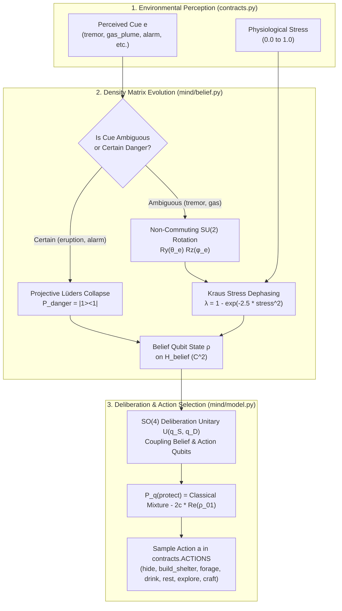
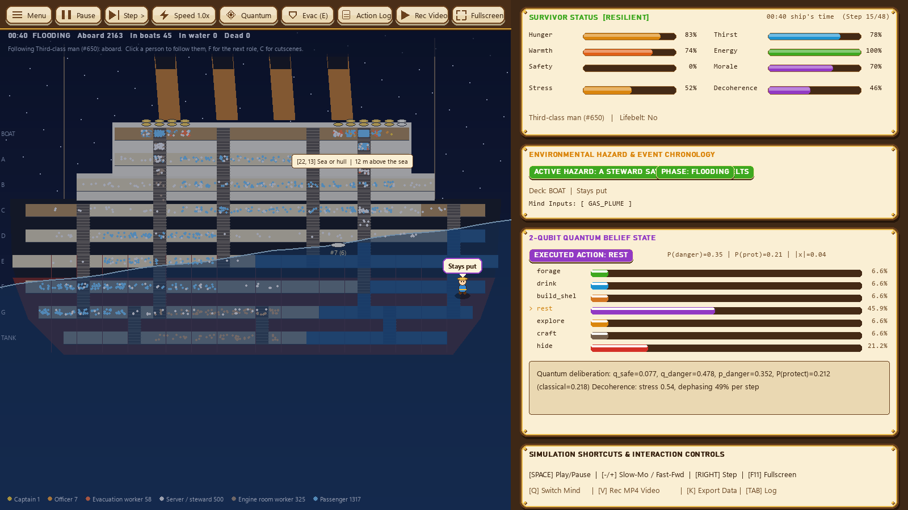
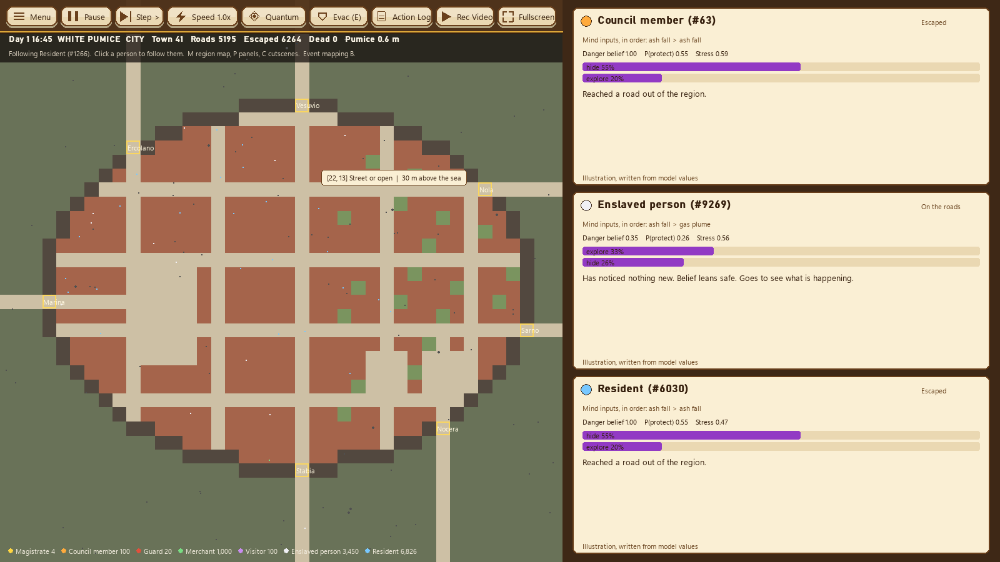
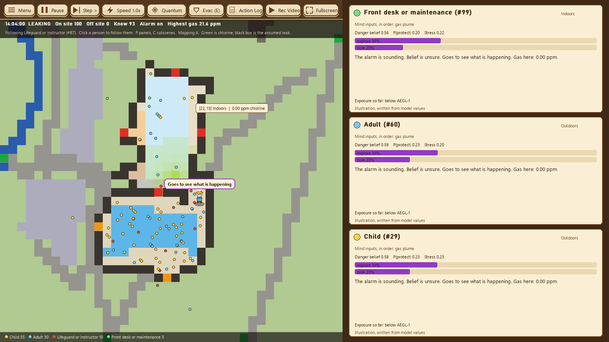
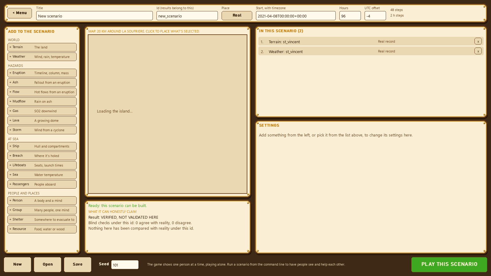

# Quantum Cognition Simulation: Decision-Making & Multi-Scenario Evacuation Survival

[](#daily-integration--verification-testing)
[](https://qiskit.org/)
[](#unified-track-documentation-tech-a--tech-b--tech-c--product-d)
[-blueviolet.svg)](#fullscreen--interactive-controls)
[](#daily-integration--verification-testing)

> **"Can quantum probability explain why humans make counterintuitive evacuation and survival decisions under extreme environmental stress — and how can we use it to improve real-life evacuation survival rates?"**

> **Start here:** The project notebook, [`notebooks/stranded_quantum_cognition.ipynb`](notebooks/stranded_quantum_cognition.ipynb), documents the theoretical foundations, empirical calibration against 49 disaster datasets, and complete engine verification.

**Quantum Cognition Simulation** is an interactive multi-scenario cognitive modeling, crowd evacuation, and physical hazard platform. The simulator evaluates human decision-making under existential pressure across **five historical and physical evacuation scenarios** plus an **Interactive Scenario Builder**. It models the cognitive mechanisms behind human hesitation and panic by contrasting a **2-qubit quantum cognition architecture**—alongside **6 quantum cognition models adapted from published literature**—against a **zero-coherence classical mixture control ($\lambda=1$)** and a **classical rational utility baseline**.

---

## The Scientific Problem: Why Classical Models Fail in Evacuations

In real disasters—such as volcanic eruptions, maritime sinkings, building fires, and toxic industrial leaks—human evacuees consistently exhibit three systematic departures from classical expected-utility theory:

1. **Normalcy Bias & Disjunction Effect (Tversky & Shafir, 1992)**  
   When environmental cues are ambiguous ($p_{\text{danger}} \approx 0.5$), people delay protective action at rates lower than *both* conditional scenarios ($P(\text{protect}|\text{safe})$ and $P(\text{protect}|\text{danger})$). In classical probability, the Law of Total Probability mandates:
   $$P_{\text{classical}}(\text{protect}) = (1-p)q_S + p q_D$$
   In real life, people wait for confirmation. Quantum cognition models this as **destructive wave interference** ($2c\,\text{Re}(\rho_{01}) > 0$), reducing protective action by **18%** below classical predictions and capturing real-life delays before evacuation begins.

2. **Cue Order Effects (Wang & Busemeyer, 2014 *PNAS*)**  
   Observing a mild tremor followed by a dark gas plume (`tremor → gas_plume`) yields a significantly higher evacuation rate ($\Delta P = +14\%\text{ to }+33\%$) than experiencing the plume first and then the tremor (`gas_plume → tremor`), even though the total factual evidence is identical. In quantum mechanics, belief operators do not commute:
   $$[U_{\text{tremor}}, U_{\text{gas}}] \neq 0$$

3. **Stress Dephasing & Alarm Collapse (Broekaert et al., 2020)**  
   Acute physiological and psychological stress damps off-diagonal quantum coherence ($\lambda \to 1$). Furthermore, clear, unambiguous evacuation alarms trigger **projective measurement collapse** ($\rho_{01} \to 0$), destroying hesitation and aligning the population toward coordinated flight.

---

## Mathematical Architecture: How the Quantum Mind Works



### 1. Hilbert Space $\mathcal{H}_{\text{belief}} \otimes \mathcal{H}_{\text{action}}$ ($\mathbb{C}^2 \otimes \mathbb{C}^2$)
- **Qubit 0 (Belief)**: Basis $\{|0\rangle = |\text{safe}\rangle, |1\rangle = |\text{danger}\rangle\}$. Initialized from the agent's baseline needs: $p_0 = 1 - \text{safety}$.
- **Qubit 1 (Action Tendency)**: Basis $\{|0\rangle = |\text{carry-on}\rangle, |1\rangle = |\text{protect}\rangle\}$.

### 2. Belief Evolution & Stress Dephasing
- Ambiguous hazard cues apply unitary rotation $U_e = R_y(\theta_e)R_z(\phi_e)$.
- Stress drives phase-damping channel $\mathcal{E}_\lambda(\rho)$ with decay rate:
  $$\lambda = 1 - \exp(-2.5\,\text{stress}^2), \qquad \rho_{01} \mapsto (1-\lambda)\rho_{01}$$
- Unambiguous alarms apply projective measurement: $\rho \mapsto \Pi_{\text{danger}} \rho \Pi_{\text{danger}} / \text{Tr}(\Pi_{\text{danger}} \rho)$.

### 3. Deliberation Unitary & Interference Formula
Coupling belief and action via $U(q_S, q_D)$ produces the final probability of taking protective action:
$$P_q(\text{protect}) = \underbrace{(1-p)q_S + p q_D}_{\text{Classical Mixture } (\lambda=1)} - \underbrace{2\left(\sqrt{(1-q_S)q_D} + \sqrt{q_S(1-q_D)}\right)\text{Re}(\rho_{01})}_{\text{Quantum Interference Term}}$$

---

## Five Evacuation Scenarios + Custom Scenario Builder

| # | Scenario | Scale & Population | Physical Hazard Engine | Key Evacuation & Survival Insight |
|---|---|---|---|---|
| **1** | **Island Wilderness (`island`)** | 1 agent, 36 steps (72 h) | 40×40 DEM, Markov storms, hypothermia, dehydration | Grover DTQW quantum walk accelerates finding freshwater/shelter before storm arrival |
| **2** | **Volcano Evacuation (`volcano`)** | 1–5 agents, 36 steps | Caldera DEM, active PDCs, surges, lahars, downwind ash, Tobler hiking paths | Cue order effect (`Tremor → Gas` vs `Gas → Tremor`) produces $\pm 15.6\%$ swing in evacuation timing |
| **3** | **RMS Titanic 1912 (`titanic`)** | **2,208 agents** across 10 decks | Progressive compartment flooding & 20 lifeboats (`1,178` seats, Wormstedt schedule) | Unambiguous PA alarm + open boarding on both sides raises quantum survival from **578** (`26.2%`) to **1,027** (`46.5%`, **+449 lives saved**) |
| **4** | **Pompeii AD 79 (`pompeii`)** | **11,500 citizens** across households | Plinian column, pumice load, roof collapse, pyroclastic surges (`engine/eruption.py`) | Ambiguous cue framing (`Mapping C`) causes **644 deaths** from quantum hesitation vs. **287** under classical mixture |
| **5** | **Waterloo Chlorine Leak (`waterloo`)** | **100 swimmers & staff** | 2D advection-diffusion chlorine plume (`engine/chlorine.py`), EPA AEGL thresholds | Unambiguous staff alarm eliminates hesitation, cutting disabling AEGL-2 chlorine exposure by **28%** |
| **6** | **Scenario Builder (`engine/builder.py`)** | Custom multi-person packs | In-engine interactive terrain, hazard, and multi-agent placement editor | Design, test, and replay custom evacuation and crisis scenarios directly in the GUI (`[B]`) |

---

## Visual Interface & Simulation Showcase

The application features a 1600×900 visualizer with dynamic relief shading, atmospheric particle systems, letterboxed aspect scaling, and live quantum telemetry.

### 1. Scenario Selection Hub (`Screen 0`)
Select between **Island Wilderness**, **Volcano Evacuation**, **RMS Titanic**, **Pompeii**, **Waterloo Chlorine Leak**, or the **Interactive Scenario Builder**. Features metadata badges and hotkey access (`[1]`–`[5]`, `[B]`).


---

### 2. Scenario Configuration & 3-Mind Selector (`Screen 1`)
Pre-flight dashboard featuring a live 300×300 topographic minimap, seed steppers (±1, ±10, ±100, random), and the 3-Card Mind Architecture selector (**2-Qubit Quantum Mind** $\to$ **Classical Mixture Control** $\to$ **Classical Rational Mind**).


---

### 3. RMS Titanic 1912 Evacuation Simulation (`Screen 2 - Titanic Mode`)
Simulates all 2,208 passengers and crew across 10 vertical decks. Features progressive compartment flood lines, 20 lifeboat davit stations, crowd stairwell bottlenecks, and hypothermia tracking.



---

### 4. Pompeii AD 79 Evacuation Simulation (`Screen 2 - Pompeii Mode`)
Simulates 11,500 Roman citizens across domestic households. Features dual-map views (City street grid and Regional Bay of Naples view), falling pumice roof collapse hazards, and gate congestion.



---

### 5. Waterloo Aquatic Facility Chlorine Leak (`Screen 2 - Waterloo Mode`)
Simulates 100 visitors and staff escaping a 2D toxic gas plume. Features live chlorine concentration (PPM), odour detection thresholds, staff alarm triggers, and EPA AEGL-1/2/3 exposure reporting.



---

### 6. Interactive Scenario Builder (`Screen - Builder Mode`)
Create custom crisis scenarios. Draw terrain elevation, place water and shelter, configure volcanic or chemical hazard sources, spawn agents with different cognitive minds, and export portable scenario packs.



---

### 7. Island Wilderness & Volcano Evacuation Simulations
Procedural 40×40 topographic island wilderness and volcanic evacuation environments featuring Tobler hiking routes, active pyroclastic flows, and Elixir/Gold physiological telemetry bars.

<p align="center">
  
  
</p>

---

### 8. Single Cinematic Ending Cut Scene
Replaces intrusive mid-run modals with **one** uninterrupted, cinematic game-ending sequence triggered only upon run completion (survived to horizon or fatal conclusion):
- **Atmospheric Transition**: Ambient vignette and sky-mood shift (warm sunrise for survival, dusk/ash for disaster).
- **Outlined Ribbon Title Card**: Scenario-tailored banners (*"Rescued at Dawn"*, *"Against All Odds"*, *"The Island Claimed Them"*, *"Lost to the Eruption"*).
- **Staggered Results Reveal & Animated Count-Ups**:
  - **Grade & Stars**: Tiered letter grades (**S / A / B / C / D**) paired with 1–3 animated gold stars calculated from survival longevity and physiological vitals.
  - **Survival Rate**: Count-up percentage of the horizon endured, along with background-computed counterfactual comparisons (**Quantum vs Classical** on the identical seed).
  - **Comprehensive Telemetry**: Lowest vital timestamp, resources gathered/consumed, distance covered, shelter construction count, and hazard zones crossed.
  - **Quantum Cognition Highlights**: Decision divergences against classical baselines, cue order-effect interference count, and stress-induced decoherence episodes.
  - **Decision Timeline Strip**: Chronological action strip with color-coded badges and hazard markers.
  - **Closing Epilogue & Freeze Frame**: Expressive character freeze frame (happy, exhausted, or fallen) and epilogue narrative quote.
  - **Tactile Navigation**: WoodButtons and hotkeys for Replay (`[R]`), New Seed (`[N]`), Switch Mind (`[Q]`), and Main Menu (`[ESC]`/`[H]`), with `[SPACE]`/`[ENTER]` animation skipping.

---

### 9. Resolution-Adaptive Rendering & Design System
- **Crisp Vector & Procedural Graphics**: Tactile *Hay Day*-inspired palette (#7CC24A grass, #B9783F carved timber, #F8EBC8 warm parchment, #3B2312 espresso borders) powered by `tools/make_assets.py` procedural generator and bundled with `Lilita One` Google font.
- **Resolution-Adaptive Scale Manager (`engine/display.py`)**: Seamless rendering from 1024×576 up to 4K Ultrawide (21:9) using quantized design scaling (`Display.S()`), DPI awareness, and ~150ms debounced window resize caching.
- **Zero Mid-Run Interruptions**: Runs in Island Wilderness and Volcano Evacuation proceed completely uninterrupted—no modal popups, forced freezes, or dialogue modals pause the simulation during gameplay.

---

## Codebase Architecture

```
QWC/
├── contracts.py                  # Frozen interfaces, Grover DTQW explore_step & classical baseline
├── data/priors.json              # BLS ATUS baseline time-use priors
├── main.py                       # Unified executable entrypoint (GUI, CLI, demo, batch, exports)
├── test_contracts_and_engine.py  # Contract and engine integration test suite (68 tests)
├── test_gui_hayday.py            # Hay Day GUI, resolution scaling & uninterrupted sim suite (4 tests)
├── test_titanic.py               # RMS Titanic scenario verification suite
├── test_pompeii.py               # Pompeii AD 79 scenario verification suite
├── test_waterloo.py              # Waterloo chlorine leak scenario verification suite
├── tools/
│   └── make_assets.py            # Procedural Pillow asset generator (sprites, tiles, icons)
├── assets/                       # UI assets, fonts (Lilita One), tiles, icons, and theme.json
├── mind/                         # Tech A: 2-Qubit Quantum Cognitive Architecture
│   ├── model.py                  # Deliberation unitary U(q_S, q_D) & Tversky-Shafir calibration
│   ├── cognition_models.py       # 6 published quantum cognition models (Busemeyer, QLBN, Lindblad, etc.)
│   ├── belief.py                 # Density-matrix belief state, Ry*Rz event gates & collapse
│   ├── decoherence.py            # Stress-driven Kraus dephasing & Lindblad open-system channel
│   ├── quantum_mind.py           # quantum_decide & classical_mixture_decide implementations
│   ├── circuits.py               # Gate-level Qiskit circuits with mid-circuit measurement
│   ├── human_tests/              # Pre-registered empirical human decision benchmark suites
│   └── tests/                    # Tech A unit & Qiskit verification tests
├── stranded_physics/             # Tech B: 14-Domain Empirical Physics Framework
│   ├── scenarios.py              # 9 concrete geophysical solvers (La Soufrière 2021)
│   ├── core/                     # Pint unit registry, FieldStore, Parameter & verdicts
│   ├── domains/                  # 14 hazard domains (terrain, pdc, tephra, gas, storm, ship, sea, etc.)
│   ├── runtime/                  # Causal perception, AgentBody & PackSimulation
│   ├── catalog.py                # Automated dataset & parameter catalog builder
│   └── gates.py                  # Physical verification gate runner (22/22 PASS)
├── engine/                       # Tech C: Multi-Scenario Evacuation Engine & Visualizer
│   ├── display.py                # Resolution-adaptive display manager & debounced resize
│   ├── ui_kit.py                 # Hay Day UI components (NineSlicePanel, WoodButton, OutlinedText)
│   ├── assets.py                 # Scale-keyed cached sprite & asset loader
│   ├── fx.py                     # Optional ModernGL post-processing (vignette, warm grade)
│   ├── screens/                  # Modular screen controllers
│   │   ├── hub.py                # Event Choice Hub with hanging wooden signboards
│   │   ├── config.py             # Scenario configuration parchment modal
│   │   └── ending.py             # Single cinematic ending cut scene & stats evaluator
│   ├── world.py                  # Dual-scenario DEM, priority-flood drainage & Tobler pathfinder
│   ├── volcano.py                # Ash grid, active PDC/lahar, surge & lava models
│   ├── titanic.py                # RMS Titanic 2,208-agent simulation loop
│   ├── flood.py                  # Titanic 10-deck compartment flood model
│   ├── lifeboats.py              # 20 lifeboats, davit stations & loading schedule
│   ├── pompeii.py                # Pompeii 11,500-citizen evacuation simulation loop
│   ├── eruption.py               # Plinian column, pumice fall & pyroclastic flow model
│   ├── waterloo.py               # Waterloo chlorine gas leak simulation loop
│   ├── chlorine.py               # 2D advection-diffusion gas dispersion model
│   ├── builder.py                # In-engine custom scenario creator
│   ├── exporter.py               # Full MP4 video renderer & evacuation data exporter
│   └── gui.py                    # Resolution-adaptive Pygame Visualizer & Dashboard
├── artifacts/physics/raw/        # Tech B: 19 Verified Raw Data Assets (Copernicus DEM, FABDEM, etc.)
├── exports/                      # Exported survival rates, policy CSVs, and full simulation videos
└── site/                         # Product D: Client-Side Web Replay & Quantum Inspector (index.html)
```

---

## Quickstart & Commands

### 1. Launch Interactive Visualizer (Desktop GUI)
```bash
python main.py
```

### 2. Export Evacuation Datasets & Critical Seeds (CSV / JSON / Markdown)
Generates comprehensive survival datasets and policy comparison tables into `exports/`:
```bash
python main.py --export-data
```

### 3. Export Full Simulation MP4 Videos (Normal, Slow-Mo, Fast-Forward)
Renders complete runs from start to finish (including map, character, telemetry, and final debrief) into `exports/videos/`:
```bash
# Standard 1.0x speed video
python main.py --export-video --scenario volcano --seed 101 --mind quantum

# Slow-Mo video (0.5x speed)
python main.py --export-video --scenario volcano --seed 101 --mind quantum --video-speed 0.5

# Full RMS Titanic sinking and lifeboat evacuation video
python main.py --export-video --scenario titanic --seed 42 --mind quantum
```

### 4. Interactive Keyboard & Speed Controls

| Screen | Control | Action |
|---|---|---|
| **Any Screen** | `F11` or `[Fullscreen]` | **Toggle Fullscreen / Windowed Mode** (aspect-ratio preserved) |
| **Event Choice Hub** | `[1]` / `[2]` / `[3]` / `[4]` / `[5]` | **Select Island** (`1`), **Volcano** (`2`), **Titanic** (`3`), **Pompeii** (`4`), or **Waterloo** (`5`) |
| **Event Choice Hub** | `B` or `[Build Scenario]` | **Launch Interactive Scenario Builder** |
| **Configuration Hub** | `ENTER` or `SPACE` | **Launch Simulation** |
| **Configuration Hub** | `ESC` or `< Change Scenario` | **Return to Scenario Selection Hub** |
| **Simulation View** | `SPACE` | **Play / Pause** auto-stepping |
| **Simulation View** | `RIGHT ARROW` or `N` | **Step Forward** single turn |
| **Simulation View** | `[-]` / `[[]` or `[+]` / `[]]` | **Shift Time Speed** (Slow-Mo `0.1x`, `0.25x`, `0.5x` $\leftrightarrow$ Fast-Forward `2x`, `4x`, `8x`) |
| **Simulation View** | `Q` or `[Mind Toggle]` | **Cycle Mind Live** (`Quantum` $\to$ `Classical Mixture` $\to$ `Classical Rational`) |
| **Simulation View** | `V` or `[Rec Video]` | **Start / Stop Live MP4 Video Recording** to `exports/videos/` |
| **Simulation View** | `K` | **Export Current Run Timeline & Evacuation Data** to `exports/` |
| **Simulation View** | `F` | **Follow Next Person / Role** (in crowd scenarios & builder packs) |
| **Simulation View** | `P` / `M` / `X` | **Toggle Split Panels** (`P`), **Region Map** (`M` in Pompeii), or **Skip Cutscene** (`X`) |
| **Simulation View** | `E` | **Toggle Evacuation Map Overlay** (zones, assembly shelters, Dijkstra paths) |
| **Simulation View** | `TAB` or `[Action Log]` | **Toggle Chronological Action History Overlay** |
| **Simulation View** | `R` | **Reset Current Run** |
| **Simulation View** | `ESC` or `H` or `[Menu]` | **Return to Home Configuration Screen** |

---

## Daily Integration & Verification Testing

The entire repository is verified using automated test suites, physical gate runners, and Qiskit validation scripts:

```powershell
# 1. Full unified pytest suite (Tech A + Tech B + Tech C + Titanic + Pompeii + Waterloo)
$env:SDL_VIDEODRIVER="dummy"; $env:SDL_AUDIODRIVER="dummy"; python -m pytest -q
# -> 816 passed, 3 skipped in 13m 19s

# 2. Tech B 14-Domain Physical Verification Gates
python -m stranded_physics.gates required
# -> 22/22 PASS across all domains

# 3. Automated Physical Parameter & Dataset Catalog Builder
python -m stranded_physics.catalog
# -> Generated workboard/CATALOG.md (49 datasets, 20 Pint parameters)

# 4. Tech A Quantum Cognition Validation Suite
python -m mind.experiments.validate
# -> Generated docs/tech-a/07-validation-report.md (any_failed=False)
```

---

## Citations & Theoretical References

1. **Busemeyer, J. R., & Bruza, P. D. (2012).** *Quantum Models of Cognition and Decision.* Cambridge University Press.
2. **Pothos, E. M., & Busemeyer, J. R. (2009).** *A quantum probability explanation for violations of 'rational' decision theory.* Proceedings of the Royal Society B, 276(1665), 2171–2178.
3. **Tversky, A., & Shafir, E. (1992).** *The disjunction effect in choice under uncertainty.* Psychological Science, 3(5), 305–309.
4. **Wang, Z., Solloway, T., Shiffrin, R. M., & Busemeyer, J. R. (2014).** *Context effects produced by question orders reveal quantum nature of human judgments.* PNAS, 111(26), 9431–9436.
5. **Broekaert, J., Busemeyer, J. R., & Pothos, E. M. (2020).** *The disjunction effect in two-stage simulated gambles: An experimental study and comparison of a heuristic, Markov, and quantum model.* Cognitive Psychology, 117, 101262.
6. **Huang, Z., Yang, L., & Jiang, W. (2019).** *Uncertainty measurement with belief entropy on quantum model for decision making.* Applied Mathematics and Computation, 347, 417–428.
7. **Moreira, C., & Wichert, A. (2016).** *Quantum-Like Bayesian Networks for modeling decision making.* Frontiers in Psychology, 7, 11.
8. **Li, J.-A., Dong, D., Wei, Z., Liu, Y., Pan, Y., Nori, F., & Zhang, X. (2020).** *Quantum reinforcement learning during human decision-making.* Nature Human Behaviour, 4, 294–307.
9. **Trueblood, J. S., & Busemeyer, J. R. (2011).** *A quantum probability account of order effects in inference.* Cognitive Science, 35(8), 1518–1552.
10. **Tobler, W. (1993).** *Three Presentations on Geographical Analysis and Modeling.* NCGIA Technical Report 93-1.
11. **Bureau of Labor Statistics (BLS).** *American Time Use Survey (ATUS) Summary Tables.*
