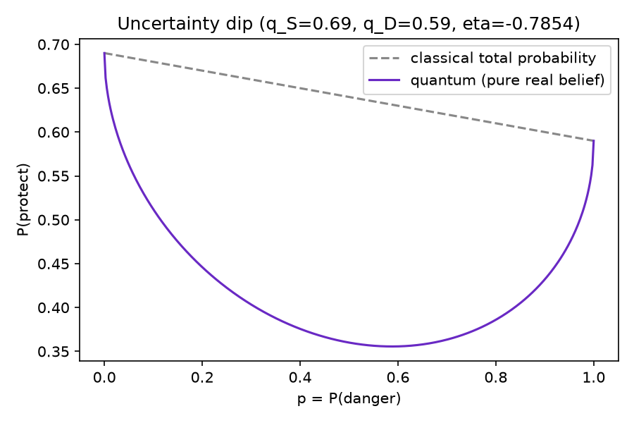

# Why an unsure evacuee waits

An agent who is genuinely unsure whether the danger is real protects
*less* than either an agent who knows they're safe or one who knows
they're in danger — the model's `P(protect)` dips to 0.356 at maximum
uncertainty, below both the "safe" conditional (0.69) and the "danger"
conditional (0.59), and below what simply averaging those two would give
(0.631 at the same point). This mirrors a well-documented human pattern
(the Tversky & Shafir 1992 disjunction effect), not a quirk of this one
game. In our 200-seed volcano batch, this didn't show up as a consistent
*delay* in when agents evacuated — the two minds usually `hide` on the
same step either way, because the current prior stub weights `hide` so
heavily once any volcanic sign appears that it mostly outweighs the dip.
It does show up elsewhere: the two minds choose different actions on 8.3%
of all compared steps (`07-validation-report.md`, Section 2). The honest
summary: the hesitation mechanism is real and tested (Stage 1, 6/6 tests);
whether it visibly delays evacuation depends on the prior it's combined
with, and in this stub, mostly it doesn't.

