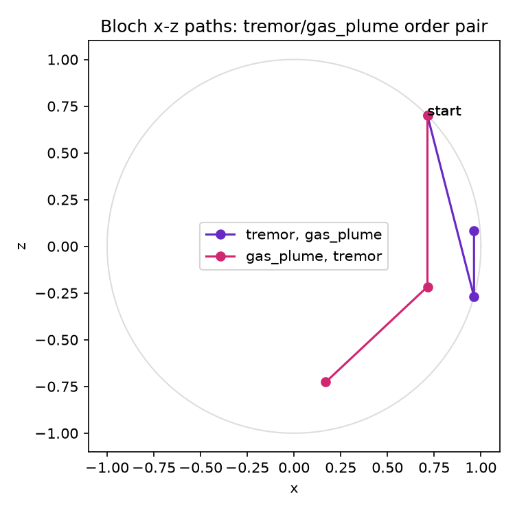

# Why the order of warning signs matters

Feeling a tremor and then smelling gas leaves the agent in a measurably
different belief than smelling gas and then feeling the tremor, even
though it's the same two signs either way — because the model represents
them as rotations around *different* axes of the belief, and rotations
about different axes don't commute. For the game's starting agent, that
difference is large enough to flip the chosen action: tremor-then-gas
gives `P(protect)=0.129` and the agent `explore`s; gas-then-tremor gives
`P(protect)=0.457` and the agent `hide`s instead — a gap of 0.328
(`05-decision-rule-and-reflexes.md`). Across the full 200-seed batch, the
two minds (quantum vs. its non-interfering control) disagree on 8.3% of
all compared decisions, which is this effect (and others like it)
compounding over a run, not a one-off (`07-validation-report.md`, Section
2). This is a real, tested property of the math (`test_order_noncommutation_tremor_gas_plume`),
not a scripted "gotcha" — the same two warnings, reordered, are genuinely
a different belief state.

