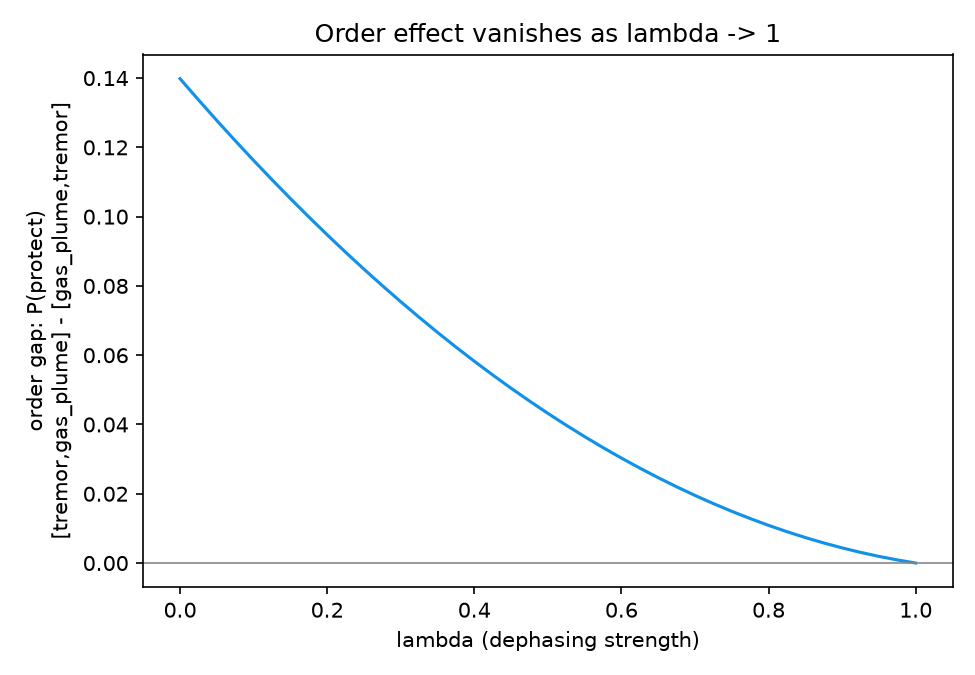

# Stress turns a quantum mind classical

Every time a new sign arrives, the belief loses a little of its
coherence, scaled to how stressed the agent currently is — at low stress
almost nothing is lost, but as stress climbs toward its cap the belief
loses coherence after essentially every sign. Without that loss, order
matters a lot: for one representative three-sign sequence the order gap
in `P(protect)` starts at 0.140 at zero stress. As dephasing increases
toward full strength, that same gap shrinks smoothly to exactly zero —
not approximately zero, but to within `1e-16` in our own tests
(`04-stress-and-decoherence.md`), which is floating-point-exact agreement,
not a coincidence. At that point `P(protect)` equals the plain classical
average of the "safe" and "danger" conditionals, with no interference
term left at all. In-game, stress 0.85 already reaches `lambda=0.929`
(93% of the way to that fully classical limit) — so a sufficiently
stressed agent in this game is, by design, making decisions almost
indistinguishably from the non-quantum control mind.

