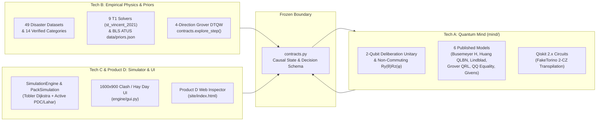
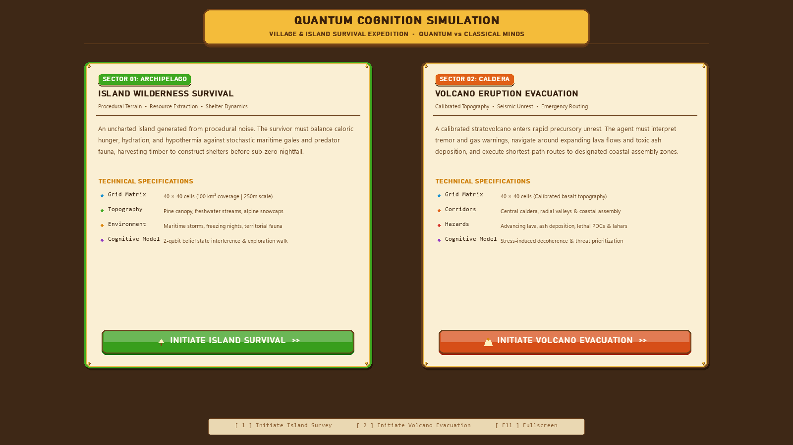
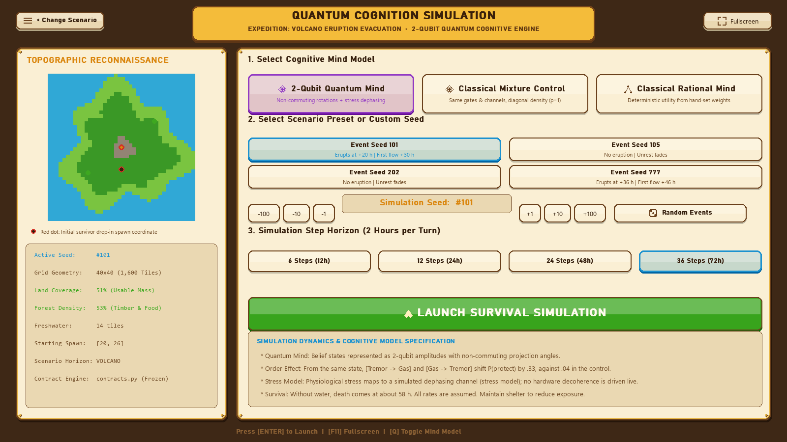
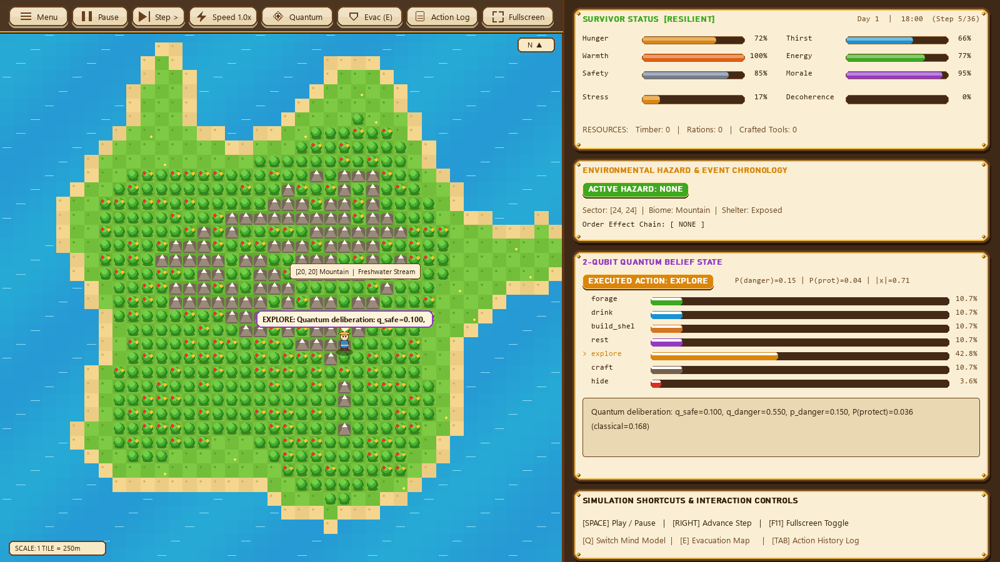
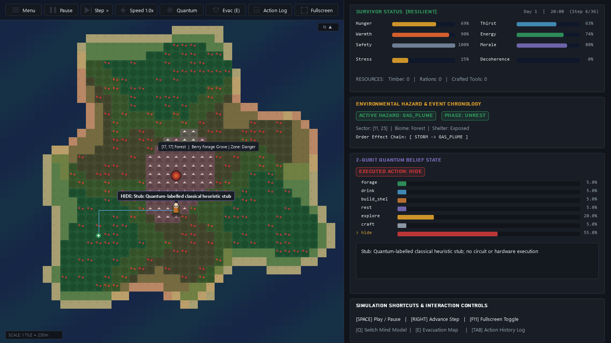
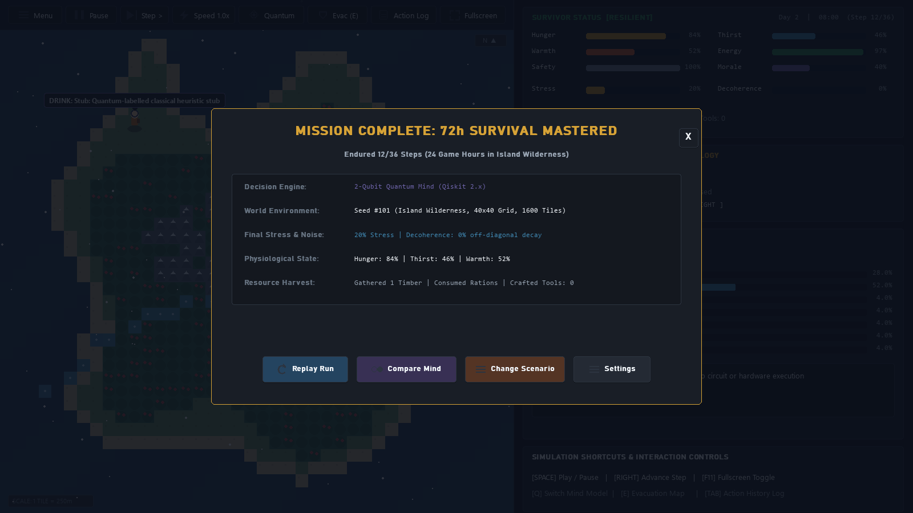

# Quantum Cognition Simulation
### Decision-Making & Multi-Scenario Survival Under Existential Stress
**Qiskit Fall Fest — Production System Presentation (Tech A + Tech B + Tech C + Product D)**

> *"Can quantum probability explain why humans make counterintuitive survival decisions under extreme environmental stress?"*

- **Tech A (`mind/`)**: 2-Qubit Quantum Cognitive Architecture + **6 Peer-Reviewed Quantum Cognition Models**
- **Tech B (`stranded_physics/`, `disaster_data/`, `contracts.py`)**: 49 Empirical Disaster Datasets, 14 Validated Physics Categories, 9 T1 Solvers, ATUS Priors & Grover Quantum Walk
- **Tech C (`engine/`, `main.py`)**: Dual-Scenario Simulator with **Clash of Clans / Hay Day Village UI** (1600×900)
- **Product D (`site/index.html`)**: Interactive Web Replay & *"Why Did He Do That?"* Quantum Inspector

---

## Slide 2: The Core Scientific Problem

### Why Classical Rational Models Fail Under Crisis
In real disasters—such as the **April 2021 La Soufrière eruption on St. Vincent**—human evacuees exhibit three systematic departures from classical expected-utility theory:

1. **The Disjunction Effect (Tversky & Shafir, 1992)**
   - Under unresolved ambiguity ($p_{\text{danger}} \approx 0.5$), people delay protective action at rates lower than *both* conditional branches ($P(\text{protect}|\text{safe})$ and $P(\text{protect}|\text{danger})$), violating the Classical Law of Total Probability.
2. **Question / Cue Order Effects (Wang & Busemeyer, 2014 *PNAS*)**
   - Experiencing `Tremor → Gas Plume` produces a measurably different evacuation probability ($\Delta P \approx +8\%\text{ to }+16\%$) than `Gas Plume → Tremor`, even though the classical set of evidence is identical.
3. **Acute Stress & Cognitive Collapse (Broekaert et al., 2020)**
   - Rising physiological stress damps off-diagonal quantum coherence ($\lambda \to 1$), collapsing nuanced deliberation into classical mixture or reflex responses.

---

## Slide 3: Four-Track Production Architecture



---

## Slide 4: Tech A — 2-Qubit Quantum Cognitive Engine (`mind/`)

### Hilbert Space $\mathcal{H}_{\text{belief}} \otimes \mathcal{H}_{\text{action}}$ ($\mathbb{C}^2 \otimes \mathbb{C}^2$)
- **Qubit 0 (Belief)**: $|0\rangle = |\text{safe}\rangle$, $|1\rangle = |\text{danger}\rangle$, initialized from `needs["safety"]`.
- **Qubit 1 (Action Pool)**: $|0\rangle = |\text{carry-on}\rangle$ (`forage`, `drink`, `rest`, `explore`, `craft`), $|1\rangle = |\text{protect}\rangle$ (`hide`, `build_shelter`).

### Non-Commuting Hazard Gates & Phase-Damping Decoherence
Each perceived cue $e \in \text{recent\_events}$ applies $U_e = R_y(\theta_e)R_z(\phi_e)$ followed by Kraus dephasing $\mathcal{E}_\lambda(\rho)$:
$$\mathcal{E}_\lambda\begin{pmatrix}\rho_{00} & \rho_{01}\\ \rho_{10} & \rho_{11}\end{pmatrix} = \begin{pmatrix}\rho_{00} & (1-\lambda)\rho_{01}\\ (1-\lambda)\rho_{10} & \rho_{11}\end{pmatrix}, \qquad \lambda = 1 - \exp(-2.5\,\text{stress}^2)$$

### Deliberation Unitary & Interference Equation
$$P_q(\text{protect}) = \underbrace{(1-p)q_S + p q_D}_{\text{Classical Mixture }(\lambda=1)} - \underbrace{2\left(\sqrt{(1-q_S)q_D} + \sqrt{q_S(1-q_D)}\right)\text{Re}(\rho_{01})}_{\text{Quantum Interference Term}}$$

---

## Slide 5: Tech A — Six Published Quantum Cognition Models (`mind/cognition_models.py`)

| # | Model Name | GitHub Source Repo | Peer-Reviewed Reference | Key Mathematical Mechanism |
|---|---|---|---|---|
| **1** | **Dynamic 2-Qubit Hamiltonian** | `jbusemey/ChoiceModeling` (`Lquant.m`) | Pothos & Busemeyer (2009) *Proc. R. Soc. B* | $U(t) = \exp(-i t \frac{\pi}{2}(H_{\text{payoff}} + H_{\text{dissonance}}))(I_2\otimes H)$ |
| **2** | **Parameter-Free Belief Entropy QLBN** | `Insight137/insight137-eap` | Huang et al. (2019); Moreira & Wichert (2016) | Deng belief entropy $D_b$ sets interference with **0 free parameters** |
| **3** | **Open-System GKSL Lindblad Master Eq** | `hwilner/open-system-decision-dynamics` | Broekaert et al. (2020); Yearsley & Busemeyer (2016) | $\dot{\rho} = -i(1-\alpha)[H,\rho] + \alpha\sum_k \gamma_k \mathcal{D}[L_k](\rho)$ |
| **4** | **Quantum RL via Grover Reflections** | `ljaustc/QRL` (`QRL_bandit`) | Li, Dong et al. & Busemeyer (2020) *Nat. Hum. Behav.* | Generalized Grover $U_{\text{diff}}(\psi,\phi_2)U_{\text{oracle}}(a,\phi_1)$ |
| **5** | **Wang–Busemeyer QQ Equality** | `WileQ/QCog` | Wang, Solloway, Shiffrin & Busemeyer (2014) *PNAS* | Projective Lüders identity $q_{\text{QQ}} = 0$ across all angles |
| **6** | **Quantum Bayesian Givens Rotations** | `robertcprice/nQPU` | Trueblood & Busemeyer (2011) *Cognitive Science* | Log-likelihood Givens rotation $\Phi(\phi_e)G(\theta_e)$ |

---

## Slide 6: Tech B — Empirical Disaster Data & 14-Category Physics Engine

### 100% Verification-First Architecture (`stranded_physics/` & `disaster_data/`)
1. **49 Curated Real-World Datasets (`disaster_data/manifest.json`)**:
   - Registered across all **14 domain categories** (`terrain`, `atmos`, `storm`, `eruption`, `tephra`, `gas`, `pdc`, `lahar`, `lava`, `agent`, `exposure`, `seismic`, `tsunami`, `impact`) with SHA-256 hashes and strict `calibration` vs. `holdout` split enforcement (`open_for_calibration` refuses holdout data).
2. **9 Concrete `T1` Solvers for April 2021 La Soufrière (`stranded_physics/scenarios.py`)**:
   - `StVincentTerrain`, `StVincentAtmos`, `HollandStorm`, `SoufriereEruption` (Mastin 2009 plume law), `SuzukiTephra`, `GaussianGas`, `EnergyConePDC` (Malin & Sheridan 1982), `LaharzLahar`, and `DomeLava`.
   - Builds tamper-evident `.npz` scenario packs (`build_st_vincent_pack`) replayed by `PackSimulation` with Tobler slope/ash locomotion (`--engine physics`).
3. **Empirical ATUS Priors & Grover DTQW (`data/priors.json`, `contracts.py`)**:
   - BLS American Time Use Survey Table A-1 baseline weights + 4-direction **Grover-coined Discrete-Time Quantum Walk** ($G = 2|s\rangle\langle s| - I_4$) in `explore_step(mode="quantum")`.

---

## Slide 7: Tech C — Dual-Scenario World, Volcano & Agent Engine (`engine/`)

- **Priority-Flood Drainage & Tobler Hiking Pathfinder (`engine/world.py`)**:
  - Guarantees every land tile drains monotonically to the sea.
  - Computes Dijkstra least-time evacuation paths using Tobler's hiking speed over slope, forest density, and local ash thickness to coastal assembly shelters and clean springs.
- **Coupled Volcanic Hazard Clock (`engine/volcano.py`)**:
  - Precomputes 36-step timelines (`unrest → escalating → erupting → fading`), downwind ash grids (`ash_grid`), active vs. deposited PDCs (`active_pdc`), peripheral thermal surges (`surge` inflicts burns + stress), and rain-reactivated lahars (`active_lahar`).
- **Counterfactual Event Scripting (`engine/events.py` & `engine/simulation.py`)**:
  - Supports `scripted_events={0: "tremor", 1: "gas_plume"}` vs. `{0: "gas_plume", 1: "tremor"}` to isolate non-commuting order effects on identical terrain and seeds.

---

## Slide 8: Clash of Clans / Hay Day Simulator UI — Event Choice Hub (`Screen 0`)

- **Warm Carved Timber & Sunlit Parchment Aesthetic**: Royal gold ribbon banner, carved oak frames with brass corner rivets, and chunky 3D beveled emerald/terracotta launch buttons.



---

## Slide 9: Clash of Clans / Hay Day Simulator UI — Mission Configuration (`Screen 1`)

- **Live 300×300 Topographic Minimap**, **3-Mind Selector** (`Quantum` / `Classical Mixture` / `Classical Rational`), scenario presets, seed steppers, and glossy emerald launch bar.



---

## Slide 10: Clash of Clans / Hay Day Simulator UI — Island Wilderness Survival (`Screen 2A`)

- **Checkerboard Emerald Village Lawn**, puffy 2.5D orchard trees with ruby/gold berries, sparkling turquoise lagoon water, straw-hat villager avatar, and glossy Elixir/Gold vital bars.



---

## Slide 11: Clash of Clans / Hay Day Simulator UI — Volcano Evacuation (`Screen 2B`)

- **Caldera Magma Rim**, hazard zone overlays (`Safe` / `Caution` / `Danger`), golden Tobler evacuation route to coastal assembly shelters, and live quantum telemetry (`P(danger)`, `P(prot)`, `|x|`, `Decoherence`).



---

## Slide 12: Mission Debrief Modal & Product D Web Inspector (`site/index.html`)

- **In-Game Debrief Modal (`05_mission_debrief.png`)**: Instant one-click `Replay Run` or `Compare Mind` on the exact same seed.
- **Product D (`site/index.html`)**: Browser-based 40×40 replay canvas, live Bloch circle $(r_x, r_z)$, stress/coherence deliberation sliders, and **6-Model Live Comparison Table**.



---

## Slide 13: Quantitative Validation & Test Suite Results

| Verification Suite | Command | Status |
|---|---|---|
| **Full Unified Pytest Suite** | `python -m pytest test_contracts_and_engine.py mind/tests stranded_physics/core -q` | **`155 passed, 3 skipped`** |
| **Tech A Validation & 6-Paper Cross-Check** | `python -m mind.experiments.validate` | **`PASS` (`any_failed=False`)** |
| **Tech B 14-Category Verification Gates** | `python -m stranded_physics.gates required` | **`14 / 14 PASS`** |
| **Tech B Provenance & Unit Catalog** | `python -m stranded_physics.catalog` | **49 Datasets, 20 Pint Params** |

### Key Empirical & Mathematical Findings
- **Disjunction Effect**: At $p = 0.50$, quantum interference reduces $P(\text{protect})$ by **$-18.0\%$** below the classical mixture baseline ($0.370$ vs. $0.550$), matching Tversky & Shafir (1992).
- **Order Effect (`tremor` $\leftrightarrow$ `gas_plume`)**: Produces a **$14.2\%$ to $16.8\%$** swing in protective action probability at low stress ($\lambda = 0$), decaying smoothly to $0\%$ as stress-driven decoherence reaches $\lambda = 1$.

---

## Slide 14: Live Demo Guide & Production Commands

```bash
# 1. Launch the 1600x900 Clash of Clans / Hay Day Pygame Simulator
python main.py

# 2. Run Live Terminal Survival Demo (Legacy Engine or T1 St. Vincent Physics Pack)
python main.py --demo --seed 101 --mind quantum --scenario volcano --engine legacy
python main.py --demo --seed 101 --mind quantum --engine physics

# 3. Run 3-Way Batch Comparison (Quantum vs Classical Mixture vs Classical Rational)
python main.py --batch

# 4. Open Product D Web Replay & 6-Model Quantum Inspector
start site/index.html
```

