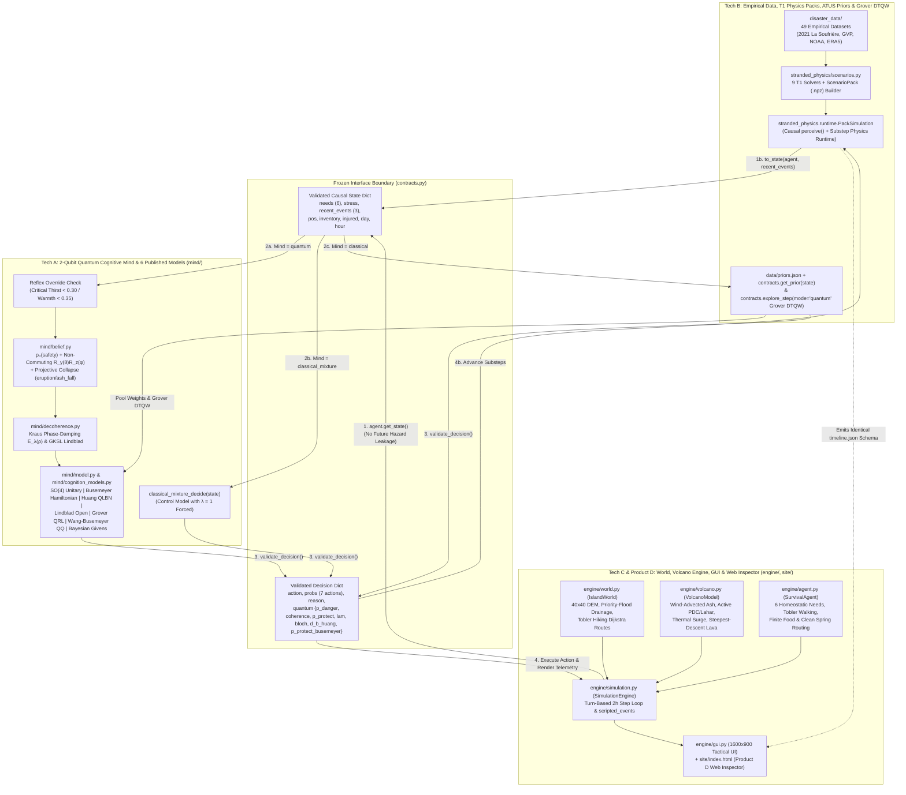

# How Tech A, Tech B, Tech C, and Product D Work Together & Separately

> **Complete Integration Guide**: This document explains how the four engineering tracks of **Quantum Cognition Simulation**—**Tech A** (`mind/`), **Tech B** (`stranded_physics/`, `disaster_data/`, `data/priors.json`, `contracts.py`), **Tech C** (`engine/`, `main.py`), and **Product D** (`site/index.html`)—operate both independently and as a single unified system.

### Companion Track Documents
- **[New Implementations & Published Quantum Cognition Models Report (`docs/NEW_IMPLEMENTATIONS_REPORT.md`)](NEW_IMPLEMENTATIONS_REPORT.md)**
- **[Tech A — 2-Qubit Quantum Cognitive Architecture (`docs/TECH_A_QUANTUM_MIND.md`)](TECH_A_QUANTUM_MIND.md)**
- **[Tech B — Empirical Disaster Calibration, Classical Priors & Physics Framework (`docs/TECH_B_PHYSICS_AND_PRIORS.md`)](TECH_B_PHYSICS_AND_PRIORS.md)**
- **[Tech C — World Generation, Volcanic Hazard Engine, Physiological Agent & GUI (`docs/TECH_C_ENGINE_WORLD_AND_GUI.md`)](TECH_C_ENGINE_WORLD_AND_GUI.md)**

---

## 1. Summary: Separately vs. Together

| Track | How It Works **Separately** | How It Works **Together** in the Unified System |
|---|---|---|
| **Tech A** (`mind/`) | Standalone 2-qubit quantum cognitive package implementing the default $SO(4)$ deliberation unitary plus **6 quantum cognition models adapted from published papers** in [`mind/cognition_models.py`](../mind/cognition_models.py) (`jbusemey/ChoiceModeling` Hamiltonian, `Insight137/insight137-eap` Belief Entropy QLBN, `hwilner/open-system-decision-dynamics` GKSL Lindblad, `ljaustc/QRL` Grover RL, `WileQ/QCog` QQ Equality, `robertcprice/nQPU` Quantum Bayesian Givens). | Plugs into `contracts.quantum_decide(state)`. Receives the agent's causal `state` from Tech C (`SimulationEngine`) or Tech B (`PackSimulation`), calls Tech B's `contracts.get_prior(state)` to split $P(\text{protect})$ and $1 - P(\text{protect})$ across the 7 survival actions, and returns action probabilities + quantum telemetry (`p_danger`, `coherence`, `p_protect`, `p_classical`, `lam`, `bloch`, `order_gap`, `d_b_huang`, `p_protect_busemeyer`) to Tech C's simulation loop, 1600×900 GUI, and Product D's web inspector. |
| **Tech B** (`stranded_physics/`, `disaster_data/`, `data/priors.json`, `contracts.py`) | Curates 49 real-world disaster datasets (anchored on the April 2021 La Soufrière eruption on St. Vincent), implements 9 simplified **stand-in solvers** in [`stranded_physics/scenarios.py`](../stranded_physics/scenarios.py) (`build_st_vincent_pack`), loads empirical BLS ATUS Table A-1 priors from [`data/priors.json`](../data/priors.json), and implements the 4-direction **Grover-coined Discrete-Time Quantum Walk (DTQW)** in `contracts.explore_step()`. | 1. Supplies `contracts.get_prior(state)` used by **both** `classical_decide` (argmax utility) and `quantum_decide` (pool weighting within `PROTECT_POOL` and `CARRY_ON_POOL`).<br>2. Provides `build_st_vincent_pack(seed)` and `PackSimulation`, an offline-solved `.npz` scenario-pack runtime selectable via `python main.py --demo --engine physics`.<br>3. Drives spatial movement during `explore` via the Grover DTQW (`mode="quantum"`) vs. classical walk (`mode="classical"`). |
| **Tech C** (`engine/`, `main.py`) | Implements the dual-scenario $40 \times 40$ world generator (`IslandWorld` with DEM, priority-flood drainage, and Tobler Dijkstra evacuation routes), `VolcanoModel`, `EventGenerator` (with `scripted_events` counterfactual support), `SurvivalAgent`, `SimulationEngine`, `batch_runner.py`, and the 1600×900 Pygame visualizer (`IslandVisualizerApp`). | Hosts the live simulation loop and interactive 1600×900 GUI. At every 2-hour step, Tech C updates weather, volcanic hazards, and physiological needs, filters the world into a strictly causal `state` dictionary, invokes Tech A (`quantum_decide`, `classical_mixture_decide`) or Tech B (`classical_decide`), executes the chosen movement/survival action on the terrain, and renders live quantum/classical telemetry. |
| **Product D** (`site/index.html`) | Self-contained HTML5/Canvas Replay Viewer & *"Why Did He Do That?"* Quantum Cognition Inspector with built-in volcanic & counterfactual presets. | Loads any `timeline.json` or `demo-pack/*.json` emitted by Tech C or Tech B, visualizing the 40×40 map, Bloch circle vector $(r_x, r_z)$, stress decoherence $\lambda$, and live side-by-side predictions of all 6 published quantum cognition models. |

---

## 2. Unified System Architecture Diagram



---

## 3. Verification & Full Repository Test Suite

All tracks are continuously verified together via `pytest`:

```powershell
# Run the complete 158-test unified suite across Tech A, Tech B, and Tech C:
$env:SDL_VIDEODRIVER="dummy"; python -m pytest test_contracts_and_engine.py mind/tests stranded_physics/core -q
```

- **[`test_contracts_and_engine.py`](../test_contracts_and_engine.py)** (66 tests): Validates frozen contracts, BLS ATUS `data/priors.json` metadata, 4-direction Grover DTQW `explore_step()`, dual-scenario terrain & DEM generation, priority-flood drainage, Tobler hiking speeds, active vs. deposited PDC/lahar lethality, `scripted_events` order-effect counterfactuals, `build_st_vincent_pack()` + `PackSimulation`, selectable `cognition_model` modes, and 3-mind cycling in the Pygame GUI.
- **[`mind/tests/`](../mind/tests/)** (48 tests, including 12 tests in `test_cognition_models.py`): Validates density-matrix positivity, Tversky & Shafir calibration, non-commuting order effects, phase-damping decoherence limits, reflex overrides, Qiskit circuit equivalence (including `allow_collapse=True`), and all 6 published quantum cognition models (`jbusemey/ChoiceModeling`, `Insight137/insight137-eap`, `hwilner/open-system-decision-dynamics`, `ljaustc/QRL`, `WileQ/QCog`, `robertcprice/nQPU`).
- **[`stranded_physics/core/tests/`](../stranded_physics/core/tests/)** (44 tests): Validates `pint` unit checking, dataset calibration/holdout split enforcement, domain encapsulation, topological `ScenarioPack` building, SHA-256 tamper detection, causal `perceive()` anti-future-leakage, and `PackSimulation` JSON schema compatibility.
