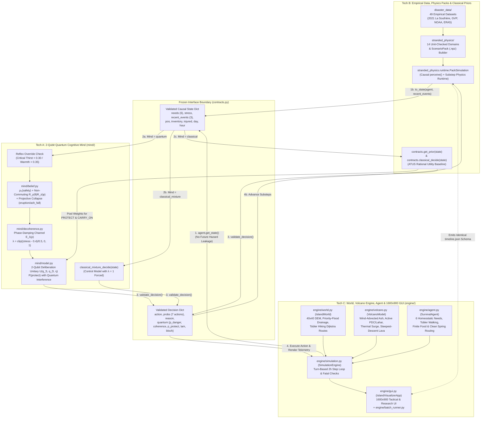

# How Tech A, Tech B, and Tech C Work Together & Separately

> **Complete Integration Guide**: This document explains how the three engineering tracks of **Quantum Cognition Simulation**—**Tech A** (`mind/`), **Tech B** (`stranded_physics/`, `disaster_data/`, `contracts.get_prior`), and **Tech C** (`engine/`, `contracts.py`, `main.py`)—operate both independently and as a single unified system.

### Companion Track Documents
- **[Tech A — 2-Qubit Quantum Cognitive Architecture (`docs/TECH_A_QUANTUM_MIND.md`)](TECH_A_QUANTUM_MIND.md)**
- **[Tech B — Empirical Disaster Calibration, Classical Priors & Physics Framework (`docs/TECH_B_PHYSICS_AND_PRIORS.md`)](TECH_B_PHYSICS_AND_PRIORS.md)**
- **[Tech C — World Generation, Volcanic Hazard Engine, Physiological Agent & GUI (`docs/TECH_C_ENGINE_WORLD_AND_GUI.md`)](TECH_C_ENGINE_WORLD_AND_GUI.md)**

---

## 1. Summary: Separately vs. Together

| Track | How It Works **Separately** | How It Works **Together** in the Unified System |
|---|---|---|
| **Tech A** (`mind/`) | Standalone 2-qubit quantum cognitive package. Given any valid `state` dict, prepares belief density matrix $\rho_0$ from `safety`, applies non-commuting $R_y(\theta)R_z(\phi)$ event gates (`tremor`, `gas_plume`, `storm`, etc.) or projective collapse (`eruption`, `ash_fall`), applies phase-damping decoherence $\mathcal{E}_\lambda$ driven by `stress`, executes the 2-qubit deliberation unitary $U(q_S, q_D, \eta)$, and validates circuits on Qiskit / `FakeTorino`. | Plugs directly into `contracts.quantum_decide(state)`. Receives the agent's causal `state` from Tech C (`SimulationEngine`) or Tech B (`PackSimulation`), calls Tech B's `contracts.get_prior(state)` to split $P(\text{protect})$ and $1 - P(\text{protect})$ across the 7 survival actions, and returns action probabilities + quantum telemetry (`p_danger`, `coherence`, `p_protect`, `lam`, `bloch`) to Tech C's simulation loop and 1600×900 GUI. |
| **Tech B** (`stranded_physics/`, `disaster_data/`, `contracts.py` priors) | Curates 49 real-world disaster datasets (anchored on the April 2021 La Soufrière eruption on St. Vincent), defines the 14-domain unit-checked (`pint`) physics framework (`FieldStore`, `Parameter`, `ScenarioPack`, `gates.py`), and defines the ATUS-grounded classical utility prior `contracts.get_prior(state)` and rational baseline `contracts.classical_decide(state)`. | 1. Supplies `contracts.get_prior(state)` used by **both** `classical_decide` (argmax utility) and `quantum_decide` (pool weighting within `PROTECT_POOL` and `CARRY_ON_POOL`).<br>2. Calibrates the physical constants, eruption timelines, and hazard thresholds used in Tech C.<br>3. Provides `PackSimulation`, an offline-solved `.npz` scenario-pack runtime that runs Tech A and Tech B minds and outputs the exact `timeline.json` schema consumed by Tech C's GUI. |
| **Tech C** (`engine/`, `main.py`) | Implements the dual-scenario $40 \times 40$ world generator (`IslandWorld` with DEM, priority-flood drainage, and Tobler Dijkstra evacuation routes), `VolcanoModel`, `EventGenerator`, `SurvivalAgent`, `SimulationEngine`, `batch_runner.py`, and the 1600×900 Pygame visualizer (`IslandVisualizerApp`). Can run standalone even if `mind/` is absent via fallback stubs in `contracts.py`. | Hosts the live simulation loop and interactive GUI. At every 2-hour step, Tech C updates weather, volcanic hazards, and physiological needs, filters the world into a strictly causal `state` dictionary, invokes Tech A (`quantum_decide`, `classical_mixture_decide`) or Tech B (`classical_decide`), executes the chosen movement/survival action on the terrain, and renders live quantum/classical telemetry. |

---

## 2. Unified System Architecture Diagram



---

## 3. The Frozen Contract Boundary (`contracts.py`)

All communication between Tech A, Tech B, and Tech C passes through [`contracts.py`](../contracts.py). Neither Tech A (`mind/`) nor Tech B (`stranded_physics/`) is ever tightly coupled to Tech C's internal `IslandWorld` or `VolcanoModel` classes.

### 3.1 Frozen Action & Event Vocabularies
- **`ACTIONS` (7 actions)**:
  `["forage", "drink", "build_shelter", "rest", "explore", "craft", "hide"]`
- **`EVENTS` (10 events)**:
  `["storm", "injury", "find_food", "animal", "cold_night", "none", "tremor", "gas_plume", "eruption", "ash_fall"]`
- **`TILE_TYPES` (5 terrain codes)**:
  `{0: "water", 1: "plains", 2: "forest", 3: "mountain", 4: "shelter"}`

### 3.2 Causal Isolation Guarantee (Anti-Future-Leakage)
A core scientific requirement across all three tracks is that **decision engines must never see hidden volcano state or future hazard schedules**:
- In **Tech C** (`engine/simulation.py`), `SurvivalAgent.get_state()` strips out `VolcanoModel.phases`, `onset_step`, `first_pdc_step`, and `hazard_by_step`, exposing only the agent's internal `needs`, `stress`, `pos`, `inventory`, `injured`, `day`, `hour`, and the 3-step `recent_events` buffer (`test_eruption_safety_stress_and_hidden_mind_state`).
- In **Tech B** (`stranded_physics/runtime/perception.py`), `perceive(pack, xy_m, t_s)` samples physical fields strictly at `(xy_m, t_s)`. Modifying future arrays after step $t$ is mathematically proven by `test_minds_cannot_see_the_future` to leave all decisions up to step $t$ unchanged.

---

## 4. Step-by-Step Execution Lifecycle (How One 2-Hour Turn Works)

When the simulation advances by one 2-hour step $t \in \{0, \dots, 35\}$ in `SimulationEngine.step()`:

1. **Environmental & Volcanic Hazard Update (Tech C — `engine/volcano.py` & `engine/world.py`)**:
   - In volcano mode, `SimulationEngine._apply_volcano(t)` reads step $t$ of `VolcanoModel.hazard_by_step[t]`:
     - Updates `world.ash` and the $40 \times 40$ wind-advected `world.ash_grid`.
     - Adds new steepest-descent lava tiles (`new_lava`) and permanent PDC/lahar deposits (`new_pdc`, `new_lahar`) to `world`.
     - Sets current-step active lethal flow footprints (`active_pdc`, `active_lahar`) and the 1-tile peripheral thermal `surge` rim.
2. **Start-of-Step Hazard Contact Check (Tech C — `engine/simulation.py`)**:
   - If the agent's current tile is inside `world.lava`, `active_pdc`, or `active_lahar`, the agent dies immediately (`"lava"`, `"pyroclastic_flow"`, or `"lahar"`).
   - If the agent is on a peripheral `surge` tile, ` _injure()` inflicts thermal burns (`injured = True`, `stress += 0.18`, `safety -= 0.15`).
3. **Event Perception & Physiological Reaction (Tech C — `engine/events.py` & `engine/agent.py`)**:
   - `EventGenerator.get_world_event(t, agent.pos)` returns the perceived environmental event (`"eruption"`, `"ash_fall"`, `"tremor"`, `"gas_plume"`, `"storm"`, `"cold_night"`, or `"none"`).
   - `agent.apply_event(event, in_shelter)` updates `recent_events` (sliding window of length 3), increments `stress`, reduces `safety`, and sets `volcanic_sign_seen = True` if a volcanic cue occurred.
4. **Causal State Extraction & Validation (Tech C $\rightarrow$ `contracts.py`)**:
   - `state = agent.get_state()` packages the 9 contract keys, and `contracts.validate_state(state)` verifies every key and range.
5. **Cognitive Deliberation (Tech A & Tech B via `contracts.py`)**:
   - **If `mind_type == "quantum"` (`mind.quantum_mind.quantum_decide`)**:
     1. Checks critical reflex overrides (`thirst < 0.30` $\rightarrow$ `drink`; `warmth < 0.35` in safe zone $\rightarrow$ `build_shelter`).
     2. Prepares initial belief density matrix $\rho_0$ on qubit 0 from `state["needs"]["safety"]`.
     3. Applies each event in `state["recent_events"]` as either a non-commuting unitary $R_y(\theta_e)R_z(\phi_e)$ followed by stress phase-damping $\mathcal{E}_\lambda(\rho)$ (where $\lambda = \text{clip}((\text{stress}-0.4)/0.5, 0, 1)$) or a projective measurement collapse onto $|1\rangle\langle 1|$ (`eruption` / `ash_fall`).
     4. Evaluates the 2-qubit deliberation unitary $U(q_S, q_D, \eta)$ to obtain $P(\text{protect})$, including the quantum interference term $\frac{x}{2}\sin(\eta)\sin(q_S + q_D)$.
     5. Calls **Tech B's** `contracts.get_prior(state)` to split $P(\text{protect})$ between `("hide", "build_shelter")` and $1 - P(\text{protect})$ across `("forage", "drink", "rest", "explore", "craft")`.
   - **If `mind_type == "classical_mixture"` (`mind.quantum_mind.classical_mixture_decide`)**:
     - Runs the exact same Tech A pipeline with $\lambda = 1.0$ forced ($x = 0$), removing quantum interference while keeping identical marginal danger beliefs and pool splitting.
   - **If `mind_type == "classical"` (`contracts.classical_decide`)**:
     - Computes **Tech B's** ATUS physiological utility distribution `contracts.get_prior(state)` and deterministically selects $\arg\max_a P_{\text{prior}}(a|\text{state})$.
6. **Physical Action Execution & Tobler Navigation (Tech C — `engine/agent.py`)**:
   - `agent.execute_action(action, world, mind_type)` moves the agent along Tobler least-time Dijkstra paths (`hide` toward coastal assembly points if warned; `drink` toward nearest clean water; `forage` at local food patches; `explore` via quantum superposition spread or classical walk), updates inventory, and applies physiological decay (`tick_needs`).
7. **Post-Move Activity Events & End-of-Step Survival Check (Tech C — `engine/simulation.py`)**:
   - Resolves post-move activity events (`find_food`, `injury`, `animal`), checks if the agent walked into an active flow or succumbed to `dehydration`, `starvation`, or `hypothermia`, and appends the step record (including `quantum` Bloch/coherence telemetry) to `steps`.

---

## 5. Three-Way Cognitive Benchmark (`engine/batch_runner.py`)

Because all three cognitive models conform to `contracts.validate_decision`, [`engine/batch_runner.py`](../engine/batch_runner.py) runs paired counterfactual experiments across identical seeds (`SimulationEngine(seed=s)`):

1. **Quantum Mind (`quantum_decide`)**: Exhibits **interference under ambiguity** (Tversky–Shafir disjunction effect when $\lambda < 1$) and **non-commuting order sensitivity** (`["tremor", "gas_plume"]` vs. `["gas_plume", "tremor"]`).
2. **Classical Mixture Control (`classical_mixture_decide`)**: Isolates the exact effect of off-diagonal quantum coherence $x = 2\,\text{Re}(\rho_{01})$ by forcing $\lambda = 1$ while keeping all gate angles and pool weights identical.
3. **Classical Rational Baseline (`classical_decide`)**: Evaluates traditional utility maximization over homeostatic needs and ATUS activity priors.

---

## 6. Verification & Full Repository Test Suite

All three tracks are continuously verified together via `pytest`:

```bash
# Run the complete 142-test unified suite across Tech A, Tech B, and Tech C:
python -m pytest test_contracts_and_engine.py mind/tests stranded_physics/core -q
```

- **[`test_contracts_and_engine.py`](../test_contracts_and_engine.py)** (62 tests): Validates frozen contracts, dual-scenario terrain & DEM generation, priority-flood drainage, Tobler hiking speeds, active vs. deposited PDC/lahar lethality, dilute surge injury, rain lahar reactivation, wind-advected ash grids, agent physiology, and headless Pygame GUI navigation.
- **[`mind/tests/`](../mind/tests/)** (37 tests): Validates density-matrix positivity, Tversky & Shafir calibration, non-commuting order effects, phase-damping decoherence limits, reflex overrides, and Qiskit circuit equivalence.
- **[`stranded_physics/core/tests/`](../stranded_physics/core/tests/)** (43 tests): Validates `pint` unit checking, dataset calibration/holdout split enforcement, domain encapsulation, topological `ScenarioPack` building, SHA-256 tamper detection, causal `perceive()` anti-future-leakage, and `PackSimulation` JSON schema compatibility.

