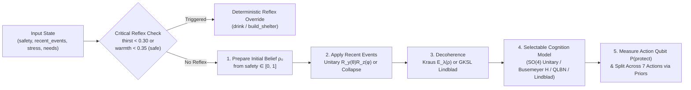

# Tech A: 2-Qubit Quantum Cognitive Architecture (`mind/`)

> **Track Scope**: Tech A implements the quantum cognitive decision engine (`mind/`), modeling how human belief states evolve under ambiguous sequential hazards, how non-commuting mental rotations produce **order effects** and **disjunction (interference) effects**, and how acute physiological stress induces **phase-damping decoherence** or **open-system Lindblad relaxation**. It also includes **6 quantum cognition models adapted from published papers** ported from open-source research repositories.

---

## 1. Architectural Overview

Tech A operates as a standalone, mathematically self-contained cognitive module. Its only external interface requirement is the frozen state and decision contract defined in [`contracts.py`](../contracts.py):

- **Input**: `state: dict` containing physiological `needs` (`hunger`, `thirst`, `warmth`, `energy`, `safety`, `morale`), `stress` $\in [0, 1]$, `recent_events` (up to 3 recent hazard strings), `injured`, `day`, `hour`, and `inventory`.
- **Output**: `decision: dict` containing `"action"` ($\in \text{ACTIONS}$), `"probs"` (normalized 7-action probability distribution), `"reason"` (human-readable diagnostic explanation), and `"quantum"` (telemetry dictionary with `p_danger`, `coherence`, `p_protect`, `p_classical`, `lam`, `bloch`, `order_gap`, `cognition_model`, `d_b_huang`, and `p_protect_busemeyer`).



---

## 2. Module Breakdown (`mind/`)

| File | Responsibility |
|---|---|
| [`mind/model.py`](../mind/model.py) | Defines the 2-qubit Hilbert space ($\mathcal{H}_{\text{belief}} \otimes \mathcal{H}_{\text{action}}$), the deliberation unitary $U(q_S, q_D, \eta)$, closed-form $P(\text{protect})$ equations, Bloch vector extraction, and least-squares calibration to Tversky & Shafir (1992). Re-exports Busemeyer Hamiltonian and Huang QLBN models. |
| [`mind/cognition_models.py`](../mind/cognition_models.py) | Implements **6 quantum cognition models adapted from published papers** backed by published papers and GitHub repositories (`jbusemey/ChoiceModeling`, `Insight137/insight137-eap`, `hwilner/open-system-decision-dynamics`, `ljaustc/QRL`, `WileQ/QCog`, `robertcprice/nQPU`). |
| [`mind/belief.py`](../mind/belief.py) | Prepares initial belief density matrix $\rho_0$ from `safety`, defines the event parameter table (`EVENT_PARAMS`), applies non-commuting $R_y(\theta) R_z(\phi)$ unitary gates or projective measurement collapse, and runs sequential event histories. |
| [`mind/decoherence.py`](../mind/decoherence.py) | Maps physiological `stress` to phase-damping strength $\lambda \in [0, 1]$ via a piecewise-linear ramp, implements the Kraus phase-damping channel $\mathcal{E}_\lambda(\rho)$, and re-exports open-system GKSL Lindblad evolution (`lindblad_rhs`, `evolve_lindblad`). |
| [`mind/quantum_mind.py`](../mind/quantum_mind.py) | Main entrypoint exposing `quantum_decide(state, cognition_model=...)` and the zero-coherence control model `classical_mixture_decide(state)`, including reflex overrides and prior-weighted action pool splitting. |
| [`mind/circuits.py`](../mind/circuits.py) | Builds gate-level Qiskit `QuantumCircuit` objects (`build_decision_circuit` with `allow_collapse=True` mid-circuit `reset+x`, `build_coherence_probe_circuit`, `build_busemeyer_hamiltonian_circuit`, `build_luders_sequence_circuit`) that transpile to IBM Heron processors (`FakeTorino`). |
| [`mind/experiments/`](../mind/experiments/) | Standalone reproducible validation scripts (`validate.py` with automated 6-paper `library_cross_check()`) generating JSON data and publication figures in [`docs/tech-a/figures/`](tech-a/figures/). |

---

## 3. Core Mathematical Formulation

### 3.1 The 2-Qubit Hilbert Space
Tech A represents the agent's internal cognitive state using two qubits:
1. **Qubit 0 — Belief State** ($\mathcal{H}_B$):
   - $|0\rangle_B \equiv |\text{safe}\rangle$: The island environment is manageable; normal survival activities are appropriate.
   - $|1\rangle_B \equiv |\text{danger}\rangle$: An existential volcanic or environmental threat is imminent.
2. **Qubit 1 — Action Disposition** ($\mathcal{H}_A$, initialized in $|0\rangle_A$):
   - $|0\rangle_A \equiv |\text{carry-on}\rangle$: Resource-gathering and maintenance pool (`forage`, `drink`, `rest`, `explore`, `signal`).
   - $|1\rangle_A \equiv |\text{protect}\rangle$: Defensive and evacuation pool (`hide`, `build_shelter`).

### 3.2 Initial Belief Preparation (`prepare_belief`)
At the start of deliberation, the agent's baseline safety perception $s = \text{clip}(\text{needs}[\text{"safety"}], 0, 1)$ prepares a pure state on the $X\text{–}Z$ meridian of the Bloch sphere:

$$|\psi_0\rangle = R_y(\theta_0)|0\rangle, \qquad \theta_0 = 2\arcsin\left(\sqrt{1 - s}\right)$$

yielding initial danger probability $p_0 = \langle 1|\rho_0|1\rangle = 1 - s$ and initial coherence $\text{Re}(\rho_{0,01}) = \sqrt{s(1-s)}$.

### 3.3 Sequential Event Operators & Non-Commutativity (`apply_event`)
Each event $e \in \text{recent\_events}$ (excluding `"none"`) transforms the $2 \times 2$ belief density matrix $\rho$ via one of two physical mechanisms:

1. **Unitary Threat/Relief Rotation (`kind = "unitary"`)**:
   Applies $U_e = R_y(\theta_e) R_z(\phi_e)$ followed immediately by the stress phase-damping channel $\mathcal{E}_\lambda$:
   - `tremor`: $(\theta = +0.45\pi, \phi = +0.35\pi)$
   - `gas_plume`: $(\theta = +0.35\pi, \phi = -0.40\pi)$
   - `storm`: $(\theta = +0.30\pi, \phi = +0.25\pi)$
   - `animal`: $(\theta = +0.35\pi, \phi = -0.30\pi)$
   - `injury`: $(\theta = +0.30\pi, \phi = -0.35\pi)$
   - `cold_night`: $(\theta = +0.20\pi, \phi = +0.20\pi)$
   - `find_food`: $(\theta = -0.15\pi, \phi = 0.00)$ (shifts belief back toward $|\text{safe}\rangle$)

   Because $\phi_e \neq 0$, sequential hazard gates do not commute ($[U_{\text{tremor}}, U_{\text{gas\_plume}}] \neq 0$). Receiving `["tremor", "gas_plume"]` versus `["gas_plume", "tremor"]` rotates the belief state along different trajectories on the Bloch sphere, producing a measurable **order effect** ($|P(\text{protect}|A,B) - P(\text{protect}|B,A)| \approx 0.168$ at $\lambda = 0$).

2. **Projective Collapse (`kind = "collapse"`)**:
   Unambiguous volcanic onset events (`eruption`, `ash_fall`) perform a projective measurement onto the danger basis state:
   $$\rho \mapsto |1\rangle\langle 1| = \begin{pmatrix} 0 & 0 \\ 0 & 1 \end{pmatrix}$$
   In [`mind/circuits.py`](../mind/circuits.py), passing `allow_collapse=True` compiles this directly into mid-circuit `qc.reset(0); qc.x(0)` instructions.

### 3.4 Stress as Phase-Damping Decoherence (`decoherence.py`)
Physiological `stress` $\in [0, 1]$ drives phase damping (dephasing in the $\{|0\rangle, |1\rangle\}$ basis):

$$\lambda(\text{stress}) = \text{clip}\left(\frac{\text{stress} - 0.40}{0.50}, 0, 1\right)$$

The phase-damping channel scales off-diagonal elements by $\sqrt{1 - \lambda}$:

$$\mathcal{E}_\lambda\begin{pmatrix} \rho_{00} & \rho_{01} \\ \rho_{10} & \rho_{11} \end{pmatrix} = \begin{pmatrix} \rho_{00} & \sqrt{1-\lambda}\,\rho_{01} \\ \sqrt{1-\lambda}\,\rho_{10} & \rho_{11} \end{pmatrix}$$

### 3.5 Deliberation Unitary & Interference Term (`model.py`)
Given the post-event belief state $\rho_B$ with danger population $p = \rho_{11}$ and real coherence $x = \text{Re}(\rho_{01})$, the default 2-qubit $SO(4)$ deliberation unitary $U(q_S, q_D)$ couples the belief qubit to the action qubit:

$$P(\text{protect}) = (1 - p)q_S + p q_D - 2\left(\sqrt{(1-q_S)q_D} + \sqrt{q_S(1-q_D)}\right)x$$

---

## 4. Six Published Quantum Cognition Models (`mind/cognition_models.py`)

In addition to the default $SO(4)$ deliberation unitary, [`mind/cognition_models.py`](../mind/cognition_models.py) implements six published mathematical models from the quantum cognition literature:

1. **Busemeyer Dynamic 2-Qubit Hamiltonian (`cognition_model="busemeyer_hamiltonian"`)**
   - *Source*: [`jbusemey/ChoiceModeling`](https://github.com/jbusemey/ChoiceModeling) (`Lquant.m`), Pothos & Busemeyer (2009) *Proc. R. Soc. B*, Busemeyer & Bruza (2012).
   - Evolves the 2-qubit state under $U(t) = \exp(-i t \frac{\pi}{2}(H_{\text{payoff}} + H_{\text{dissonance}}))(I_2 \otimes H_{\text{Had}})$.
2. **Parameter-Free Quantum-Like Bayesian Network via Belief Entropy (`cognition_model="qlbn_entropy"`)**
   - *Source*: [`Insight137/insight137-eap`](https://github.com/Insight137/insight137-eap), Huang, Yang & Jiang (2019) *Applied Mathematics and Computation*, Moreira & Wichert (2016) *Frontiers in Psychology*.
   - Computes belief distance $d_i$ and belief entropy $D_b = \frac{\sum B_d \log_2 B_d}{\sum B_d}$ to determine quantum interference strength with zero free parameters.
3. **Open Quantum System GKSL Lindblad Master Equation (`cognition_model="lindblad_open"`)**
   - *Source*: [`hwilner/open-system-decision-dynamics`](https://github.com/hwilner/open-system-decision-dynamics), Broekaert, Busemeyer & Pothos (2020) *Cognitive Psychology*, Yearsley & Busemeyer (2016) *J. Math. Psych.*.
   - Integrates $\frac{d\rho}{dt} = -i(1-\alpha)[H,\rho] + \alpha\sum_k \gamma_k (L_k\rho L_k^\dagger - \frac{1}{2}\{L_k^\dagger L_k,\rho\})$ under stress-scaled bath coupling.
4. **Quantum Reinforcement Learning via Generalized Grover Reflections (`QuantumSequenceLearner`)**
   - *Source*: [`ljaustc/QRL`](https://github.com/ljaustc/QRL), Li, Dong et al. & Busemeyer (2020) *Nature Human Behaviour*.
   - Amplifies high-utility survival actions using Prospect-Theory utility $u(x)$ and generalized Grover reflections $U_{\text{diff}}(\psi,\phi_2)U_{\text{oracle}}(a,\phi_1)$.
5. **Wang–Busemeyer QQ Equality & Projective Lüders 2D Representability (`wang_busemeyer_qq_gap`, `verify_2d_representability`)**
   - *Source*: [`WileQ/QCog`](https://github.com/WileQ/QCog) & [`ProfessorBrunner/aggregation-observability`](https://github.com/ProfessorBrunner/aggregation-observability), Wang et al. (2014) *PNAS*.
   - Verifies $q_{\text{QQ}} = (P(A_y B_n) + P(A_n B_y)) - (P(B_y A_n) + P(B_n A_y)) = 0$ across sequential projective Lüders measurements.
6. **Quantum Bayesian Belief Updating via Givens Rotations (`quantum_bayesian_update`)**
   - *Source*: [`robertcprice/nQPU`](https://github.com/robertcprice/nQPU), Trueblood & Busemeyer (2011) *Cognitive Science*.
   - Maps log-likelihood ratios of hazard cues to non-commuting Givens rotations $G(\theta_e)$ and phase shifts $\Phi(\phi_e)$.

---

## 5. Running Tech A Standalone

```bash
# Run all 48 Tech A unit, Qiskit, and published cognition model tests
python -m pytest mind/tests -q

# Re-generate Tech A validation report (including 6-paper library_cross_check)
python -m mind.experiments.validate
```
