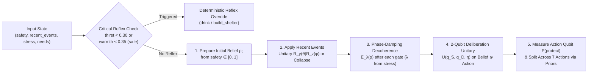

# Tech A: 2-Qubit Quantum Cognitive Architecture (`mind/`)

> **Track Scope**: Tech A implements the quantum cognitive decision engine (`mind/`), modeling how human belief states evolve under ambiguous sequential hazards, how non-commuting mental rotations produce **order effects** and **disjunction (interference) effects**, and how acute physiological stress induces **phase-damping decoherence**.

---

## 1. Architectural Overview

Tech A operates as a standalone, mathematically self-contained cognitive module. Its only external interface requirement is the frozen state and decision contract defined in [`contracts.py`](../contracts.py):

- **Input**: `state: dict` containing physiological `needs` (`hunger`, `thirst`, `warmth`, `energy`, `safety`, `morale`), `stress` $\in [0, 1]$, `recent_events` (up to 3 recent hazard strings), `injured`, `day`, `hour`, and `inventory`.
- **Output**: `decision: dict` containing `"action"` ($\in \text{ACTIONS}$), `"probs"` (normalized 7-action probability distribution), `"reason"` (human-readable diagnostic explanation), and `"quantum"` (telemetry dictionary with `p_danger`, `coherence`, `p_protect`, `lam`, and `bloch`).



---

## 2. Module Breakdown (`mind/`)

| File | Responsibility |
|---|---|
| [`mind/model.py`](../mind/model.py) | Defines the 2-qubit Hilbert space ($\mathcal{H}_{\text{belief}} \otimes \mathcal{H}_{\text{action}}$), the deliberation unitary $U(q_S, q_D, \eta)$, closed-form $P(\text{protect})$ equations, Bloch vector extraction, and least-squares calibration to Tversky & Shafir (1992). |
| [`mind/belief.py`](../mind/belief.py) | Prepares initial belief density matrix $\rho_0$ from `safety`, defines the event parameter table (`EVENT_PARAMS`), applies non-commuting $R_y(\theta) R_z(\phi)$ unitary gates or projective measurement collapse, and runs sequential event histories. |
| [`mind/decoherence.py`](../mind/decoherence.py) | Maps physiological `stress` to phase-damping strength $\lambda \in [0, 1]$ via a piecewise-linear ramp and implements the Krauss phase-damping channel $\mathcal{E}_\lambda(\rho)$. |
| [`mind/quantum_mind.py`](../mind/quantum_mind.py) | Main entrypoint exposing `quantum_decide(state)` and the zero-coherence control model `classical_mixture_decide(state)`, including reflex overrides and prior-weighted action pool splitting. |
| [`mind/circuits.py`](../mind/circuits.py) | Builds equivalent gate-level Qiskit `QuantumCircuit` objects (`build_decision_circuit`, `build_coherence_probe_circuit`) that transpile to 2 `CZ` gates on IBM Heron processors (`FakeTorino`). |
| [`mind/experiments/`](../mind/experiments/) | Standalone reproducible validation scripts generating JSON data and publication figures in [`docs/tech-a/figures/`](tech-a/figures/). |

---

## 3. Mathematical Formulation

### 3.1 The 2-Qubit Hilbert Space
Tech A represents the agent's internal cognitive state using two qubits:
1. **Qubit 0 — Belief State** ($\mathcal{H}_B$):
   - $|0\rangle_B \equiv |\text{safe}\rangle$: The island environment is manageable; normal survival activities are appropriate.
   - $|1\rangle_B \equiv |\text{danger}\rangle$: An existential volcanic or environmental threat is imminent.
2. **Qubit 1 — Action Disposition** ($\mathcal{H}_A$, initialized in $|0\rangle_A$):
   - $|0\rangle_A \equiv |\text{carry-on}\rangle$: Resource-gathering and maintenance pool (`forage`, `drink`, `rest`, `explore`, `craft`).
   - $|1\rangle_A \equiv |\text{protect}\rangle$: Defensive and evacuation pool (`hide`, `build_shelter`).

### 3.2 Initial Belief Preparation (`prepare_belief`)
At the start of deliberation, the agent's baseline safety perception $s = \text{clip}(\text{needs}[\text{"safety"}], 0, 1)$ prepares a pure state on the $X\text{–}Z$ meridian of the Bloch sphere:

$$|\psi_0\rangle = R_y(\theta_0)|0\rangle, \qquad \theta_0 = 2\arcsin\left(\sqrt{1 - s}\right)$$

yielding initial danger probability $p_0 = \langle 1|\rho_0|1\rangle = 1 - s$ and initial coherence $\text{Re}(\rho_{0,01}) = \sqrt{s(1-s)}$.

### 3.3 Sequential Event Operators & Non-Commutativity (`apply_event`)
Each event $e \in \text{recent\_events}$ (excluding `"none"`) transforms the $2 \times 2$ belief density matrix $\rho$ via one of two physical mechanisms:

1. **Unitary Threat/Relief Rotation (`kind = "unitary"`)**:
   Applies $U_e = R_y(\theta_e) R_z(\phi_e)$ followed immediately by the stress phase-damping channel $\mathcal{E}_\lambda$:
   - `tremor`: $(\theta = +0.45\pi, \phi = +0.35\pi)$
   - `gas_plume`: $(\theta = +0.35\pi, \phi = -0.40\pi)$
   - `storm`: $(\theta = +0.30\pi, \phi = +0.25\pi)$
   - `animal`: $(\theta = +0.35\pi, \phi = -0.30\pi)$
   - `injury`: $(\theta = +0.30\pi, \phi = -0.35\pi)$
   - `cold_night`: $(\theta = +0.20\pi, \phi = +0.20\pi)$
   - `find_food`: $(\theta = -0.15\pi, \phi = 0.00)$ (shifts belief back toward $|\text{safe}\rangle$)

   Because $\phi_e \neq 0$, sequential hazard gates do not commute ($[U_{\text{tremor}}, U_{\text{gas\_plume}}] \neq 0$). Receiving `["tremor", "gas_plume"]` versus `["gas_plume", "tremor"]` rotates the belief state along different trajectories on the Bloch sphere, producing a measurable **order effect** ($|P(\text{protect}|A,B) - P(\text{protect}|B,A)| \approx 0.168$ at $\lambda = 0$).

2. **Projective Collapse (`kind = "collapse"`)**:
   Unambiguous volcanic onset events (`eruption`, `ash_fall`) perform a projective measurement onto the danger basis state:
   $$\rho \mapsto |1\rangle\langle 1| = \begin{pmatrix} 0 & 0 \\ 0 & 1 \end{pmatrix}$$
   All off-diagonal coherence vanishes ($x = 0, p = 1$), eliminating interference and locking the agent into certainty of danger.

### 3.4 Stress as Phase-Damping Decoherence (`decoherence.py`)
Physiological `stress` $\in [0, 1]$ drives phase damping (dephasing in the $\{|0\rangle, |1\rangle\}$ basis):

$$\lambda(\text{stress}) = \text{clip}\left(\frac{\text{stress} - 0.40}{0.50}, 0, 1\right)$$

- Below `stress = 0.40`, $\lambda = 0$ (fully coherent quantum deliberation).
- Above `stress = 0.90`, $\lambda = 1$ (complete dephasing).

The phase-damping channel scales off-diagonal elements by $\sqrt{1 - \lambda}$:

$$\mathcal{E}_\lambda\begin{pmatrix} \rho_{00} & \rho_{01} \\ \rho_{10} & \rho_{11} \end{pmatrix} = \begin{pmatrix} \rho_{00} & \sqrt{1-\lambda}\,\rho_{01} \\ \sqrt{1-\lambda}\,\rho_{10} & \rho_{11} \end{pmatrix}$$

### 3.5 Deliberation Unitary & Interference Term (`model.py`)
Given the post-event belief state $\rho_B$ with danger population $p = \rho_{11}$ and real coherence $x = 2\,\text{Re}(\rho_{01})$, the 2-qubit deliberation unitary $U(q_S, q_D, \eta)$ couples the belief qubit to the action qubit. Tracing out the belief qubit yields the exact closed-form probability of choosing a protective action:

$$P(\text{protect}) = (1 - p)\sin^2\left(\frac{q_S}{2}\right) + p\cos^2\left(\frac{q_D}{2}\right) + \frac{x}{2}\sin(\eta)\sin(q_S + q_D)$$

- **First two terms**: Classical law of total probability (weighted average of $P(\text{protect}|\text{safe}) = \sin^2(q_S/2) \approx 0.114$ and $P(\text{protect}|\text{danger}) = \cos^2(q_D/2) \approx 0.915$).
- **Third term**: Quantum interference term proportional to coherence $x$ and $\sin(\eta)$. Calibrated to Tversky & Shafir's (1992) disjunction effect ($\eta \approx -\pi/4$), positive $X$-coherence under unresolved ambiguity constructively/destructively shifts $P(\text{protect})$ below both conditional branches ("waiting to see" under ambiguity).

### 3.6 Pool Splitting & Reflex Layer (`quantum_mind.py`)
1. **Reflex Layer**: Before running the quantum circuit, `quantum_decide` checks for life-threatening physiological deficits:
   - `thirst < 0.30` $\rightarrow$ overrides to `"drink"` with probability $0.88$.
   - `warmth < 0.35` and `safety >= 0.70` $\rightarrow$ overrides to `"build_shelter"` with probability $0.88$.
2. **Pool Splitting**: When no reflex fires, $P(\text{protect})$ is distributed across `PROTECT_POOL = ("hide", "build_shelter")` and $1 - P(\text{protect})$ is distributed across `CARRY_ON_POOL = ("forage", "drink", "rest", "explore", "craft")` proportionally to Tech B's physiological prior `contracts.get_prior(state)`.
3. **Classical Mixture Control (`classical_mixture_decide`)**: Runs the **exact same pipeline** with $\lambda = 1.0$ forced ($x = 0$), isolating the causal contribution of quantum interference ($x \neq 0$) from the marginal danger belief $p$.

---

## 4. Running Tech A Standalone

```bash
# Run all Tech A unit and integration tests (fast statevector + analytical tests)
python -m pytest mind/tests -m "not slow" -v

# Re-generate all Tech A validation experiments and figures
python -m mind.experiments.run_all
```

