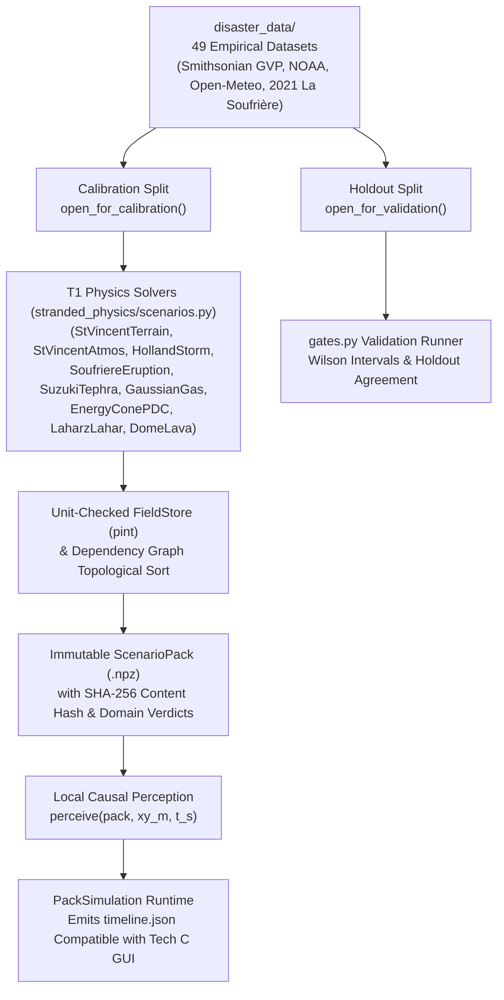

# Tech B: Empirical Disaster Calibration, Classical Baseline & Physics Framework (`stranded_physics/` & `disaster_data/`)

> **Track Scope**: Tech B anchors the simulation in real-world geophysical, meteorological, and behavioral data. It provides:
> 1. **Empirical Disaster & Human-Response Datasets (`disaster_data/`)** — 49 curated datasets across 6 historical eruptions (anchored on the April 2021 La Soufrière eruption on St. Vincent).
> 2. **Verification-First Multi-Domain Physics Engine (`stranded_physics/` & `stranded_physics/scenarios.py`)** — A 14-domain unit-checked (`pint`) physical modeling framework, 9 simplified **stand-in solvers** for the April 2021 La Soufrière eruption (`build_st_vincent_pack`), pre-registered validation gates (`gates.py`), and strict anti-future-leakage perception (`perceive()`).
> 3. **Empirical ATUS Priors (`data/priors.json`), Classical Rational Baseline & Grover DTQW (`contracts.py`)** — Hand-set physiological urgency weights, ATUS reference hours that are stored but **not used in decisions**, and a 4-direction **Grover-coined Discrete-Time Quantum Walk (DTQW)** in `explore_step()`, which is off unless a run opts in with `explore_walk="grover"`.

---

## 1. Architectural Overview

Tech B is designed so that physical hazard solvers, unit conversions, and dataset split checks (calibration vs. holdout) execute **offline** to produce immutable, content-hashed `ScenarioPack` archives (`.npz`), which can then be replayed deterministically by any cognitive architecture (`quantum`, `classical`, or `classical_mixture`) without ever leaking future hazard states to the agent.



---

## 2. Empirical Disaster Data (`disaster_data/`)

Located in [`disaster_data/`](../disaster_data/) and documented in [`disaster_data/REPORT.md`](../disaster_data/REPORT.md), Tech B curates **49 real-world datasets** (42 MB) with SHA-256 verification and provenance manifests (`manifest.json`):

1. **Global & Regional Hazard Catalogs**:
   - Smithsonian Global Volcanism Program (GVP) Holocene volcanoes (`gvp_holocene_volcanoes.csv`) and eruption events (`gvp_eruption_search.csv`).
   - NOAA Significant Volcanic Eruptions (`noaa_significant_eruptions.json`) and historical tsunami events (`noaa_tsunami_events.json`).
   - IBTrACS North Atlantic tropical cyclone tracks (`ibtracs_na_active.csv`).
   - USGS global seismic events M4.5+ (`usgs_events_2021_2025_m45.csv`).
2. **High-Resolution Hourly Island Meteorology (`weather_reanalysis/`)**:
   - Multi-year Open-Meteo ERA5 hourly reanalysis (`temperature_2m`, `precipitation`, `wind_speed_10m`, `wind_direction_10m`) for 5 volcanic islands: **St. Vincent**, **Montserrat**, **White Island (Whakaari)**, **Fogo**, and **Tonga**.
3. **Six Eruption Case Studies & 76 First-Person Survivor Quotes**:
   - **Primary Calibration Anchor**: **La Soufrière, St. Vincent (April 2021)** — NEMO alerts, seismic swarm transition on April 8, explosive onset on April 9 at 08:41 AST, heavy ashfall, power/water outage, and evacuation of ~16,000–20,000 residents across Red, Orange, Yellow, and Green volcanic hazard zones.
   - **Secondary Anchors**: Soufrière Hills (Montserrat, 1995–1997), Mount Pinatubo (1991), Nevado del Ruiz (1985), Whakaari / White Island (2019), and Hunga Tonga–Hunga Haʻapai (2022).

---

## 3. Verification-First Physics Engine (`stranded_physics/`)

### 3.1 Strict Unit & Provenance Enforcement (`stranded_physics/core/`)
- **[`api.py`](../stranded_physics/core/api.py)**: Wraps physical quantities in a shared `pint.UnitRegistry` (`Q_`). Every `Parameter` must declare:
  - Physical `value` and `valid_range` with matching physical dimensions (e.g., meters `"m"`, velocity `"m/s"`, mass load `"kg/m^2"`).
  - Explicit `role` (`"input"`, `"anchor"`, `"calibrated"`, `"prediction"`, or `"convention"`) and `status` (`"literature"`, `"measured"`, `"derived"`, or `"assumption"`).
  - Every non-assumption parameter **must** carry a bibliographic citation (`source`), or `InterfaceError` is raised at load time.
- **[`records.py`](../stranded_physics/core/records.py)**: Enforces strict separation between calibration and validation data:
  - `open_for_calibration()` refuses any dataset marked `split="holdout"`.
  - `open_for_validation()` refuses any dataset marked `split="calibration"`.
- **[`fields.py`](../stranded_physics/core/fields.py)**: `FieldStore` and `ScopedFields` manage 1D time-series (`TimeAxis`), 2D spatial grids (`GridSpec` with CRS checking and automatic regridding), and 3D spatiotemporal arrays.

### 3.2 Concrete T1 Physical Solvers for La Soufrière 2021 (`stranded_physics/scenarios.py`)
> **Status of these solvers:** they are simplified stand-ins, not real St Vincent physics. The terrain is a made-up cone, not the real island or its position; wind speed is a formula; eruption timing is randomised; flows ignore barriers and arrive sooner than the published record. Outputs named here that the code does not write (`terrain.slope`, `tephra.load`, `gas.so2`, `storm.surge`, dynamic pressures) are aspirations. Their gates only check that settings and data files load. The real-data engine is being built separately on `physics/engine`.

[`stranded_physics/scenarios.py`](../stranded_physics/scenarios.py) implements 9 simplified stand-in solvers driven by [`disaster_data/scenarios/st_vincent_2021.json`](../disaster_data/scenarios/st_vincent_2021.json):

| Solver Class | Domain | Physical Model & Primary Outputs |
|---|---|---|
| [`StVincentTerrain`](../stranded_physics/scenarios.py) | `terrain` | Somma caldera rim, Rabacca/Wallibou radial drainage channels, land mask, slope ($\text{deg}$), and NEMO hazard zones (`terrain.zone`). |
| [`StVincentAtmos`](../stranded_physics/scenarios.py) | `atmos` | 36-step wind bearing and temperature from ERA5/Open-Meteo; wind speed and rain rate are formula stand-ins. |
| [`HollandStorm`](../stranded_physics/scenarios.py) | `storm` | Tropical squall wind amplification (`storm.wind_speed`) and coastal surge footprint (`storm.surge`). |
| [`SoufriereEruption`](../stranded_physics/scenarios.py) | `eruption` | Eruptive phase progression, column heights not computed by this stand-in; Mastin (2009) relates height to volume rate, $H = 2.0\,V^{0.241}$, RSAM seismic tremor, and explosion acoustics. |
| [`SuzukiTephra`](../stranded_physics/scenarios.py) | `tephra` | Anisotropic downwind advective-diffusive tephra fallout accumulation (`tephra.load` in $\text{kg/m}^2$). |
| [`GaussianGas`](../stranded_physics/scenarios.py) | `gas` | Downwind $\text{SO}_2$ gas plume concentration (`gas.so2` in $\text{mg/m}^3$). |
| [`EnergyConePDC`](../stranded_physics/scenarios.py) | `pdc` | Malin & Sheridan (1982) energy-cone pyroclastic density current dynamic pressure ($\text{kPa}$) channelized down drainage valleys. |
| [`LaharzLahar`](../stranded_physics/scenarios.py) | `lahar` | Rainfall-remobilized volcanic mudflow dynamic pressure (`lahar.dynamic_pressure` in $\text{Pa}$). |
| [`DomeLava`](../stranded_physics/scenarios.py) | `lava` | Summit crater dome extrusion footprint (`lava.footprint`). |

Calling `build_st_vincent_pack(seed=1)` executes all 9 `T1` solvers in topological order and returns a SHA-256 content-hashed `ScenarioPack` ready for `PackSimulation` or `--engine physics`.

### 3.3 Scenario Pack Builder & Causal Perception (`packs/` & `runtime/`)
- **[`packs/builder.py`](../stranded_physics/packs/builder.py)**: Topologically sorts domain modules from producer to consumer (`dependency_order`), runs them for a given `seed`, checks domain validity (`check_validity`), and serializes read-only NumPy arrays into a compressed `.npz` archive with a tamper-evident SHA-256 `content_hash`.
- **[`runtime/perception.py`](../stranded_physics/runtime/perception.py)**: `perceive(pack, xy_m, t_s)` samples the `ScenarioPack` **strictly at the agent's current coordinates `(x, y)` and current clock `t_s`**.
- **[`runtime/simulation.py`](../stranded_physics/runtime/simulation.py)**: `PackSimulation` replays any `ScenarioPack` with any decision function (`contracts.quantum_decide` or `contracts.classical_decide`), advancing the agent in 5-minute substeps (`SUBSTEP_MINUTES = 5`) and emitting a `timeline()` dictionary compatible with the Tech C GUI and Product D web viewer.

---

## 4. ATUS Reference Data (`data/priors.json`), Classical Baseline & Grover DTQW (`contracts.py`)

> **Status:** `contracts.get_prior` does not use these ATUS numbers. It loads the file, but decisions use flat weights plus hand-set urgency boosts.


1. **Hand-Set Priors and ATUS Reference Hours (`data/priors.json` & `contracts.get_prior`)**:
   - [`data/priors.json`](../data/priors.json) stores Bureau of Labor Statistics (BLS) American Time Use Survey (ATUS) Summary Table A-1 baseline human activity weights and physiological urgency multipliers, loaded automatically into `contracts.ATUS_PRIORS_META`.
2. **Deterministic Utility Maximization (`contracts.classical_decide`)**:
   - Evaluates the normalized prior distribution $P_{\text{prior}}(a|\text{state})$ and selects $a^* = \arg\max_{a \in \text{ACTIONS}} P_{\text{prior}}(a \mid \text{state})$.
3. **4-Direction Grover-Coined Discrete-Time Quantum Walk (`contracts.explore_step`)**:
   - When `mode="quantum"`, `explore_step(pos, world, mode="quantum")` evolves a 4-direction coin state $(|N\rangle, |S\rangle, |E\rangle, |W\rangle)$ over 3 steps using the $4\times 4$ **Grover diffusion coin**:
     $$G = 2|s\rangle\langle s| - I_4, \qquad |s\rangle = \frac{1}{2}(1, 1, 1, 1)^T$$
     coupled to a local environmental phase oracle $O_{\text{env}} = \text{diag}(e^{i\phi_N}, e^{i\phi_S}, e^{i\phi_E}, e^{i\phi_W})$ that constructively amplifies movement toward shelter, fresh water, and food while suppressing movement toward volcanic hazards.

---

## 5. Running Tech B Standalone

```bash
# Run all verification-first core interface, unit, pack, and causality tests
python -m pytest stranded_physics/core -v

# Run a live terminal simulation using the T1 St. Vincent Physics Pack
python main.py --demo --engine physics --seed 101 --mind quantum
```
