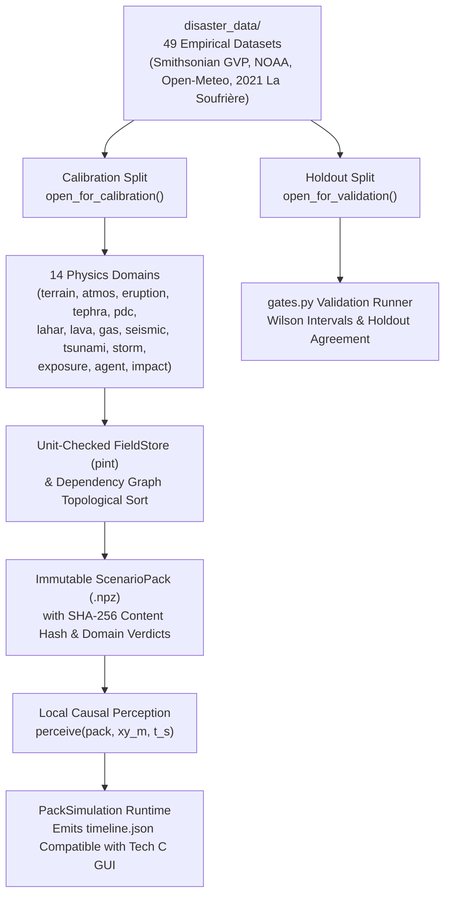

# Tech B: Empirical Disaster Calibration, Classical Baseline & Physics Framework (`stranded_physics/` & `disaster_data/`)

> **Track Scope**: Tech B anchors the simulation in real-world geophysical, meteorological, and behavioral data. It provides:
> 1. **Empirical Disaster & Human-Response Datasets (`disaster_data/`)** — 49 curated datasets across 6 historical eruptions (anchored on the April 2021 La Soufrière eruption on St. Vincent).
> 2. **Verification-First Multi-Domain Physics Engine (`stranded_physics/`)** — A 14-domain unit-checked (`pint`) physical modeling and scenario-pack framework with pre-registered validation gates (`gates.py`) and strict anti-future-leakage perception (`perceive()`).
> 3. **Classical Rational Baseline & ATUS Priors (`contracts.get_prior`, `contracts.classical_decide`)** — Physiological utility weighting grounded in American Time Use Survey (ATUS) activity tables.

---

## 1. Architectural Overview

Tech B is designed so that physical hazard solvers, unit conversions, and dataset split checks (calibration vs. holdout) execute **offline** to produce immutable, content-hashed `ScenarioPack` archives (`.npz`), which can then be replayed deterministically by any cognitive architecture (`quantum`, `classical`, or `classical_mixture`) without ever leaking future hazard states to the agent.



---

## 2. Empirical Disaster Data (`disaster_data/`)

Located in [`disaster_data/`](../disaster_data/) and documented in [`disaster_data/REPORT.md`](../disaster_data/REPORT.md), Tech B curates **49 real-world datasets** (42 MB) with SHA-256 verification and provenance manifests (`manifest.json`):

1. **Global & Regional Hazard Catalogs**:
   - Smithsonian Global Volcanism Program (GVP) Holocene volcanoes (`gvp_holocene_volcanoes.csv`) and eruption events (`gvp_eruption_search.csv`).
   - NOAA Significant Volcanic Eruptions (`noaa_significant_eruptions.json`) and historical tsunami events (`noaa_tsunami_events.json`).
   - IBTrACS North Atlantic tropical cyclone tracks (`ibtracs_na_active.csv`).
   - USGS global seismic events M4.5+ (`usgs_events_2021_2025_m45.csv`).
2. **High-Resolution Hourly Island Meteorology (`weather_reanalysis/`)**:
   - Multi-year Open-Meteo ERA5 hourly reanalysis (`temperature_2m`, `precipitation`, `wind_speed_10m`, `wind_direction_10m`) for 5 volcanic islands: **St. Vincent**, **Montserrat**, **White Island (Whakaari)**, **Fogo**, and **Tonga**.
3. **Six Eruption Case Studies & 76 First-Person Survivor Quotes**:
   - **Primary Calibration Anchor**: **La Soufrière, St. Vincent (April 2021)** — NEMO alerts, seismic swarm transition on April 8, explosive onset on April 9 at 08:41 AST, heavy ashfall, power/water outage, and evacuation of ~16,000–20,000 residents across Red, Orange, Yellow, and Green volcanic hazard zones.
   - **Secondary Anchors**: Soufrière Hills (Montserrat, 1995–1997), Mount Pinatubo (1991), Nevado del Ruiz (1985), Whakaari / White Island (2019), and Hunga Tonga–Hunga Haʻapai (2022).

---

## 3. Verification-First Physics Engine (`stranded_physics/`)

### 3.1 Strict Unit & Provenance Enforcement (`stranded_physics/core/`)
- **[`api.py`](../stranded_physics/core/api.py)**: Wraps physical quantities in a shared `pint.UnitRegistry` (`Q_`). Every `Parameter` must declare:
  - Physical `value` and `valid_range` with matching physical dimensions (e.g., meters `"m"`, velocity `"m/s"`, mass load `"kg/m^2"`).
  - Explicit `role` (`"input"`, `"anchor"`, or `"prediction"`) and `status` (`"literature"`, `"calibrated"`, `"convention"`, or `"assumption"`).
  - Every non-assumption parameter **must** carry a bibliographic citation (`source`), or `InterfaceError` is raised at load time.
- **[`records.py`](../stranded_physics/core/records.py)**: Enforces strict separation between calibration and validation data:
  - `open_for_calibration()` refuses any dataset marked `split="holdout"`.
  - `open_for_validation()` refuses any dataset marked `split="calibration"`.
- **[`fields.py`](../stranded_physics/core/fields.py)**: `FieldStore` and `ScopedFields` manage 1D time-series (`TimeSpec`), 2D spatial grids (`GridSpec` with CRS checking and automatic regridding), and 3D spatiotemporal arrays.
  - Rejects `NaN`/`Inf` values, duplicate writes, and shape mismatches.
  - Enforces **domain encapsulation**: a domain module can only read fields declared in its `inputs` tuple and can only write fields in its own category namespace (`outputs`).

### 3.2 The 14 Physics Domains (`stranded_physics/domains/`)
Each domain folder is self-contained (verified by AST import tests in `test_interfaces.py` so domains never cross-import each other) and contains its own `README.md`, `parameters.toml`, and `sources.toml`:

| Domain ID | Physical Scope & Primary Fields |
|---|---|
| `terrain` | Elevation (`terrain.elevation`), land mask (`terrain.land_mask`), slope, drainage, and hazard zones (`terrain.zone`). |
| `atmos` | Wind speed (`atmos.wind_speed`), wind direction (`atmos.wind_from_deg`), and rainfall rate (`atmos.rain_rate`). |
| `eruption` | Eruptive phase (`eruption.phase`), seismic tremor (`eruption.tremor`), explosion acoustics (`eruption.explosion`), and mass eruption rate (`eruption.mer`). |
| `tephra` | Advection-diffusion ash fallout and cumulative tephra mass load (`tephra.deposit_load` in $\text{kg/m}^2$). |
| `pdc` | Valley-confined pyroclastic density current arrival time (`pdc.arrival`), active flow mask (`pdc.active`), and dynamic pressure. |
| `lahar` | Rain-triggered volcanic mudflow depth (`lahar.depth`) and valley inundation. |
| `lava` | Steepest-descent effusive lava flow footprint (`lava.footprint`). |
| `gas` | Downwind $\text{SO}_2$ / volcanic gas plume concentration (`gas.so2_ppm`). |
| `seismic` | Ground shaking intensity and felt tremor radius. |
| `tsunami` | Coastal runup and wave arrival hazard. |
| `storm` | Tropical storm rainfall and wind exposure. |
| `exposure` | Local thermal, respiratory, and ash-load dose experienced at agent coordinates. |
| `agent` | Biomechanical locomotion (Tobler hiking speed over slope and ash) and hydration/energy expenditure. |
| `impact` | Vulnerability thresholds and survival/fatality evaluation. |

### 3.3 Scenario Pack Builder & Causal Perception (`packs/` & `runtime/`)
- **[`packs/builder.py`](../stranded_physics/packs/builder.py)**: Topologically sorts domain modules from producer to consumer (`dependency_order`), runs them for a given `seed`, checks domain validity (`check_validity`), and serializes read-only NumPy arrays into a compressed `.npz` archive with a tamper-evident SHA-256 `content_hash`.
- **[`runtime/perception.py`](../stranded_physics/runtime/perception.py)**: `perceive(pack, xy_m, t_s)` samples the `ScenarioPack` **strictly at the agent's current coordinates `(x, y)` and current clock `t_s`**.
  - Verified by `test_minds_cannot_see_the_future`: modifying a pack's future PDC arrival, tremor, or tephra arrays after step $t$ produces bit-for-bit identical agent states and events up to step $t$.
- **[`runtime/simulation.py`](../stranded_physics/runtime/simulation.py)**: `PackSimulation` replays any `ScenarioPack` with any decision function (`contracts.quantum_decide` or `contracts.classical_decide`), advancing the agent in 5-minute substeps (`SUBSTEP_MINUTES = 5`) and emitting a `timeline()` dictionary with the exact same JSON schema as Tech C's `SimulationEngine`.

### 3.4 Pre-Registered Validation Gates (`gates.py`)
- **[`gates.py`](../stranded_physics/gates.py)** and **[`core/verdicts.py`](../stranded_physics/core/verdicts.py)**: Evaluates verification and validation gates using Wilson score confidence intervals (`wilson_interval`), refusing to pass rare-event gates on insufficient sample sizes (`INSUFFICIENT_DATA`) and invalidating stale verdicts whenever a target or tolerance changes.

---

## 4. Classical Rational Baseline (`contracts.py`)

Tech B also defines the **Classical Rational Mind** (`contracts.get_prior` and `contracts.classical_decide`):
1. **ATUS Activity Priors (`get_prior`)**: Computes baseline action utilities from the agent's 6 physiological needs (`hunger`, `thirst`, `warmth`, `energy`, `safety`, `morale`), inventory (`wood`, `food`), injury status, time of day (`hour`), and recent environmental events (`storm`, `cold_night`, `animal`, `tremor`, `gas_plume`, `eruption`, `ash_fall`).
2. **Deterministic Utility Maximization (`classical_decide`)**: Evaluates the normalized prior distribution $P_{\text{prior}}(a|\text{state})$ and selects the rational utility maximum:
   $$a^* = \arg\max_{a \in \text{ACTIONS}} P_{\text{prior}}(a \mid \text{state})$$
   Unlike Tech A's quantum mind, `classical_decide` has **zero belief superposition**, **zero interference ($\eta = 0$)**, and **no order sensitivity** to the sequence in which recent events occurred.

---

## 5. Running Tech B Standalone

```bash
# Run all 43 verification-first core interface, unit, pack, and causality tests
python -m pytest stranded_physics/core -v

# Check validation gates and generate catalog
python -m stranded_physics.gates
python -m stranded_physics.catalog
```
