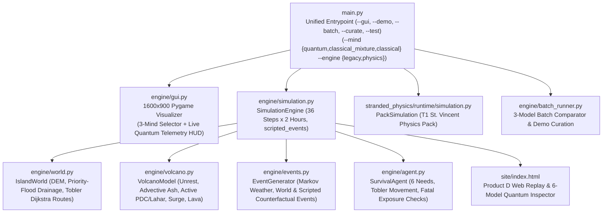

# Tech C: World Generation, Volcanic Hazard Engine, Physiological Agent, Interactive GUI & Web Replay (`engine/` & `site/`)

> **Track Scope**: Tech C provides the core simulation engine, dual-scenario world generator, volcano hazard solver, deterministic counterfactual event scripting, physiological survival agent, multi-seed batch comparator, the 1600×900 Pygame Research & Tactical Visualizer (`engine/gui.py`), and the Product D Web Replay & Quantum Cognition Inspector (`site/index.html`).

---

## 1. Architectural Overview

Tech C orchestrates the 2-hour turn-based simulation loop across a $40 \times 40$ tile island grid ($250\text{ m}$ per tile, $10\text{ km} \times 10\text{ km}$ domain) over a default 36-step ($72\text{-hour}$) horizon. It supports two distinct simulation scenarios selectable from the GUI Event Choice Hub or CLI (`--scenario`) and two execution backends (`--engine {legacy,physics}`):
1. **`scenario="volcano"` (Fictional Volcanic Island Evacuation)**: Fixed volcanic island topography (`MAP_SEED = 104729`) with a $1000\text{ m}$ central caldera, priority-flood drainage valleys, Tobler hiking routes to coastal assembly points, and seeded volcanic unrest/eruption timelines.
2. **`scenario="island"` (Procedural Wilderness Survival)**: Seed-driven procedural archipelago with organic coastline harmonics, resource gathering, shelter building, wildlife encounters, and Grover-coined quantum vs. classical exploration walks.



---

## 2. Module Breakdown (`engine/`, `main.py`, `site/`)

| File | Responsibility |
|---|---|
| [`engine/world.py`](../engine/world.py) | Generates the $40 \times 40$ grid (`IslandWorld`), digital elevation model (`elevation`), priority-flood steepest-descent drainage network (`valleys`, `drainage`), hazard zones (`zones`), coastal assembly points, clean springs, and Tobler's hiking function Dijkstra pathfinder (`travel_minutes`, `path`, `route_from_spawn`). |
| [`engine/volcano.py`](../engine/volcano.py) | Precomputes the hidden 36-step volcanic timeline (`VolcanoModel`): 4 phases (`unrest`, `escalating`, `erupting`, `fading`), wind direction drift (`wind_deg`), anisotropic downwind ash grid (`ash_grid`), rate-limited steepest-descent lava (`new_lava`), valley-confined active vs. deposited PDCs (`active_pdc`, `new_pdc`), peripheral thermal surge (`surge`), and rain-reactivated lahars (`active_lahar`, `new_lahar`). |
| [`engine/events.py`](../engine/events.py) | Generates the 3-state Markov weather chain (`calm`, `rain`, `storm`), maps volcanic phases and spatial proximity to `world_events`, resolves activity-linked events (`find_food`, `injury`, `animal`), and supports deterministic `scripted_events: Optional[Dict[int, str]]` for order-effect counterfactuals. |
| [`engine/agent.py`](../engine/agent.py) | Manages the `SurvivalAgent` physiological state (6 needs in $[0, 1]$, `stress`, `injured`, `inventory`), Tobler walking budget per 2-hour step (`movement_budget`, `follow_path`, `walk_to`), finite food patch depletion and auto-ration consumption (`eat_if_needed`), and fatal threshold checks. |
| [`engine/simulation.py`](../engine/simulation.py) | Runs the deterministic turn-based step loop (`SimulationEngine`), enforces causal state filtering (`agent.get_state()`), supports `scripted_events` overrides, records quantum/classical decision telemetry, evaluates start-of-step and end-of-step flow lethality, and exports `timeline.json` with evacuation margin summaries. |
| [`engine/batch_runner.py`](../engine/batch_runner.py) | Executes paired multi-seed comparisons across **Quantum Mind**, **Classical Mixture Control ($\lambda=1$)**, and **Classical Rational Baseline (ATUS)**, and curates signature trajectories into `demo-pack/`. |
| [`engine/gui.py`](../engine/gui.py) | 1600×900 interactive Pygame application (`IslandVisualizerApp`) featuring hardware fullscreen scaling (`F11`), Event Choice Hub (`Screen 0`), Configuration & Seed Hub (`Screen 1`) with 3-Mind Selector, Live Tactical Simulation (`Screen 2`) with live quantum telemetry readout (`|x|`, `λ`, `ΔP`), Action History Log (`TAB`), and Mission Debrief Modal. |
| [`site/index.html`](../site/index.html) | **Product D**: Self-contained HTML5/Canvas Replay Viewer & *"Why Did He Do That?"* Quantum Cognition Inspector with Bloch circle visualization, interactive stress/coherence sandbox, and live 6-model comparison table. |

---

## 3. Core Mechanics & Physical Algorithms

### 3.1 Priority-Flood Drainage & Tobler Hiking Routing (`engine/world.py`)
In volcano mode, `IslandWorld` builds a realistic digital elevation model peaking near $1000\text{ m}$ at the central vent $(20, 20)$ with four radial valleys carved from the crater to the coast:
1. **Priority-Flood Depression Filling**: Guarantees every land tile has a strictly descending path (`drainage[p] = q` with $\text{elevation}[q] < \text{elevation}[p]$) to the coastline, preventing artificial inland traps for lava and lahars.
2. **Tobler's Hiking Function (`travel_minutes`)**: Walking time between adjacent tiles $a \to b$ (distance $d = 0.25\text{ km}$ orthogonal or $0.25\sqrt2\text{ km}$ diagonal) accounts for terrain slope $s = \Delta z / (1000 d)$, off-trail vegetation multiplier ($0.6\times$ on plains, $0.48\times$ in forest, $0.3\times$ on mountain), and local tephra load:
   $$v_{\text{km/h}} = 6 \exp\left(-3.5 |s + 0.05|\right) \times f_{\text{terrain}} \times f_{\text{ash}}$$
3. **Least-Time Evacuation Routes (`routes_from_spawn`)**: Uses Dijkstra relaxation over `travel_minutes` to compute the fastest evacuation paths from the agent's camp in the Danger Zone (`zone = 2`) to two separated coastal assembly points (`zone = 0`, separated by $\ge 60^\circ$ around the vent), each paired with an adjacent ash-free clean spring (`clean_springs`).

### 3.2 Volcanic Hazard Dynamics (`engine/volcano.py`) & Scripted Counterfactuals (`engine/events.py`)
For each seed, `VolcanoModel` precomputes a 36-step hazard schedule coupled to the island's weather chain:
- **Unrest & Eruption Phases**: Progresses through `unrest` (`tremor`, `gas_plume`) $\to$ `escalating` $\to$ `erupting` (`eruption`, `ash_fall`) $\to$ `fading`. Roughly 25% of seeds remain non-eruptive false alarms to test whether the cognitive model over-evacuates or starves.
- **Deterministic Counterfactual Event Scripting (`scripted_events`)**: Both `EventGenerator` and `SimulationEngine` accept `scripted_events: Optional[Dict[int, str]] = None` (e.g. `{0: "tremor", 1: "gas_plume"}` vs. `{0: "gas_plume", 1: "tremor"}`), allowing researchers to hold the seed, map, and agent physiology identical while reversing the chronological order of hazard cues.
- **Active vs. Deposited Flows**:
  - **Pyroclastic Density Currents (`active_pdc` vs. `new_pdc`)**: High-speed valley-guided avalanches covering the proximal cone ($r \le 4.2$ tiles) on the first pulse and extending down radial valleys on subsequent pulses. Only **active** PDC pulses during the current step kill the agent (`cause_of_death = "pyroclastic_flow"`), while cooled deposits remain permanently impassable (`world.pdc`).
  - **Dilute Pyroclastic Surge (`surge`)**: A 1-tile thermal rim bordering `active_pdc` that inflicts burns (`injured = True`), +0.18 stress, and -0.15 safety without instant death.
  - **Lahars (`active_lahar` vs. `new_lahar`)**: Volcanic mudflows that propagate down stream channels when ash availability $\ge 0.22$ combines with eruptive water release or `rain`/`storm` weather.
  - **Anisotropic Wind-Advected Ash (`ash_grid`)**: A $40 \times 40$ digit grid (`'0'`–`'9'`) modeling wind-blown tephra dispersion downwind of the vent.

### 3.3 Physiological Survival Agent (`engine/agent.py`)
`SurvivalAgent` tracks six normalized homeostatic needs $\in [0, 1]$ across 2-hour steps (`hunger`, `thirst`, `warmth`, `energy`, `safety`, `morale`), walking with a 90-minute Tobler budget per step, harvesting finite food patches, drinking from clean springs or low-ash streams, and following Dijkstra evacuation paths during `hide`.

---

## 4. Interactive 1600×900 Visualizer (`engine/gui.py`) & Product D Web Viewer (`site/index.html`)

### 4.1 Pygame Tactical Visualizer (`engine/gui.py`)
Launched via `python main.py`, `IslandVisualizerApp` provides an engineered tactical research interface:
- **Screen 0 — Scenario Selection Hub (`event_choice`)**: Interactive dual-card selector between **Island Wilderness Survival** (`[1]`) and **Volcano Eruption Evacuation** (`[2]`).
- **Screen 1 — Configuration & Seed Hub (`home`)**: Live $300 \times 300$ procedural minimap preview, **3-Mind Architecture Selector** (**2-Qubit Quantum Mind**, **Classical Mixture ($\lambda=1$)**, **Classical Rational (ATUS)**), curated scenario presets, seed steppers ($\pm 1, \pm 10, \pm 100$), and step horizon selector (`12`, `24`, `36`, `48` steps).
- **Screen 2 — Live Tactical Simulation (`sim`)**:
  - Left $900 \times 900$ viewport rendering the $40 \times 40$ terrain, elevation relief, hazard zones (`E` key toggle), active/deposited lava, PDCs, lahars, wind-blown ash shading, smooth-lerped agent avatar, and weather particles.
  - Right $700 \times 900$ telemetry dashboard displaying physiological vital bars, stress & decoherence meter ($\lambda$), **live quantum telemetry strip (`|x|`, `λ`, `ΔP` interference shift)**, 7-action cognitive probability distribution, recent event register, and chronological narrative log.

### 4.2 Product D Web Replay & Quantum Inspector (`site/index.html`)
Open [`site/index.html`](../site/index.html) in any browser to inspect built-in replay presets or load any exported `timeline.json` / `demo-pack/*.json`:
- **40×40 HTML5 Canvas Field Replay** with trajectory trace, hazard overlays, and step-by-step scrubber.
- **"Why Did He Do That?" Quantum Deliberation Inspector** with live Bloch circle projection $(r_x, r_z)$, interactive stress/coherence deliberation sliders, Wang–Busemeyer QQ equality check, and a **live 6-model comparison table** evaluating all six published quantum cognition models side-by-side on the selected step.

---

## 5. Running Tech C Standalone

```bash
# Launch interactive 1600x900 Pygame GUI
python main.py

# Run terminal live ASCII simulation (Legacy Engine or T1 Physics Pack Engine)
python main.py --demo --seed 101 --mind quantum --scenario volcano --engine legacy
python main.py --demo --seed 101 --mind quantum --engine physics

# Run 20-seed batch comparison (Quantum vs Classical Mixture vs Classical ATUS)
python main.py --batch

# Run all 66 Tech C contract, terrain, volcano, counterfactual, DTQW, and GUI tests
python -m pytest test_contracts_and_engine.py -v
```
