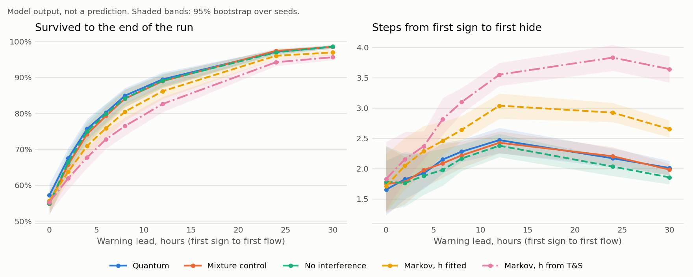

# Lead-time sweep

_Generated by `python -m mind.experiments.lead_time_figure`. Do not edit by hand. Protocols: [2a](../protocols/2a_lead_time_sweep.md), [2b](../protocols/2b_control_arms.md)._

60 seeds, 30 replicates, 4 distances, 288,000 runs. Catalogue leads: median 1.9 h, quartiles 1.1 and 5.8 h, 90th percentile 28 h, n = 22. Model output, not a prediction.

## Survival to the end of the run, all distances

| Lead (h) | Quantum | Mixture control | No interference | Markov, h fitted | Markov, h from T&S |
| --- | --- | --- | --- | --- | --- |
| 0 | 57.2% | 54.9% | 54.9% | 55.8% | 55.3% |
| 2 | 67.5% | 65.8% | 66.5% | 63.8% | 62.0% |
| 4 | 75.7% | 74.2% | 75.0% | 71.0% | 67.7% |
| 6 | 80.2% | 79.3% | 79.9% | 75.9% | 72.8% |
| 8 | 84.9% | 84.1% | 84.2% | 80.5% | 76.5% |
| 12 | 89.5% | 88.9% | 89.1% | 86.2% | 82.6% |
| 24 | 97.1% | 97.4% | 97.0% | 96.0% | 94.2% |
| 30 | 98.5% | 98.5% | 98.6% | 96.9% | 95.6% |

## Delay, first sign to first hide (steps)

| Lead (h) | Quantum | Mixture control | No interference | Markov, h fitted | Markov, h from T&S |
| --- | --- | --- | --- | --- | --- |
| 0 | 1.7 | 1.7 | 1.8 | 1.7 | 1.8 |
| 2 | 1.8 | 1.8 | 1.8 | 2.0 | 2.2 |
| 4 | 1.9 | 2.0 | 1.9 | 2.3 | 2.4 |
| 6 | 2.2 | 2.1 | 2.0 | 2.5 | 2.8 |
| 8 | 2.3 | 2.2 | 2.2 | 2.6 | 3.1 |
| 12 | 2.5 | 2.4 | 2.4 | 3.0 | 3.6 |
| 24 | 2.2 | 2.2 | 2.0 | 2.9 | 3.8 |
| 30 | 2.0 | 2.0 | 1.9 | 2.7 | 3.6 |

## Paired differences, quantum minus each control

Seed is the unit. p is Holm-adjusted across the 8 leads, within each control and metric. **Bold** means p < 0.05.

| Control | Lead (h) | Survival difference (points) | 95% interval | p | Delay difference (steps) | 95% interval | p |
| --- | --- | --- | --- | --- | --- | --- | --- |
| Mixture control | 0 | **+2.3** | +0.8 to +3.8 | 0.048 | -0.08 | -0.23 to +0.04 | 1.000 |
| Mixture control | 2 | +1.7 | +0.3 to +3.1 | 0.199 | +0.05 | -0.12 to +0.22 | 1.000 |
| Mixture control | 4 | +1.5 | +0.0 to +3.0 | 0.363 | -0.05 | -0.19 to +0.08 | 1.000 |
| Mixture control | 6 | +0.9 | -0.1 to +2.0 | 0.437 | +0.06 | -0.07 to +0.19 | 1.000 |
| Mixture control | 8 | +0.8 | -0.3 to +1.9 | 0.664 | +0.06 | -0.04 to +0.17 | 1.000 |
| Mixture control | 12 | +0.5 | -0.4 to +1.4 | 0.834 | +0.04 | -0.07 to +0.16 | 1.000 |
| Mixture control | 24 | -0.3 | -0.8 to +0.3 | 0.834 | -0.03 | -0.13 to +0.06 | 1.000 |
| Mixture control | 30 | +0.0 | -0.3 to +0.5 | 0.889 | +0.03 | -0.06 to +0.12 | 1.000 |
| No interference | 0 | **+2.3** | +0.9 to +3.8 | 0.036 | -0.13 | -0.46 to +0.11 | 1.000 |
| No interference | 2 | +1.0 | -0.4 to +2.5 | 1.000 | +0.06 | -0.10 to +0.20 | 1.000 |
| No interference | 4 | +0.7 | -0.8 to +2.2 | 1.000 | +0.04 | -0.09 to +0.17 | 1.000 |
| No interference | 6 | +0.3 | -0.7 to +1.4 | 1.000 | +0.17 | +0.01 to +0.31 | 0.126 |
| No interference | 8 | +0.7 | -0.3 to +1.8 | 1.000 | +0.11 | +0.00 to +0.22 | 0.237 |
| No interference | 12 | +0.3 | -0.6 to +1.3 | 1.000 | +0.09 | -0.01 to +0.20 | 0.364 |
| No interference | 24 | +0.2 | -0.4 to +0.7 | 1.000 | **+0.14** | +0.05 to +0.22 | 0.024 |
| No interference | 30 | -0.1 | -0.4 to +0.3 | 1.000 | **+0.15** | +0.09 to +0.23 | 0.004 |
| Markov, h fitted | 0 | **+1.4** | +0.3 to +2.7 | 0.033 | -0.05 | -0.20 to +0.08 | 0.511 |
| Markov, h fitted | 2 | **+3.7** | +2.3 to +5.1 | 0.004 | **-0.22** | -0.36 to -0.08 | 0.013 |
| Markov, h fitted | 4 | **+4.8** | +3.2 to +6.3 | 0.004 | **-0.37** | -0.59 to -0.21 | 0.004 |
| Markov, h fitted | 6 | **+4.3** | +2.9 to +5.7 | 0.004 | **-0.31** | -0.43 to -0.19 | 0.004 |
| Markov, h fitted | 8 | **+4.5** | +3.2 to +5.7 | 0.004 | **-0.36** | -0.46 to -0.26 | 0.004 |
| Markov, h fitted | 12 | **+3.3** | +2.2 to +4.4 | 0.004 | **-0.57** | -0.69 to -0.45 | 0.004 |
| Markov, h fitted | 24 | **+1.1** | +0.5 to +1.7 | 0.004 | **-0.75** | -0.87 to -0.64 | 0.004 |
| Markov, h fitted | 30 | **+1.6** | +0.9 to +2.3 | 0.004 | **-0.64** | -0.75 to -0.54 | 0.004 |
| Markov, h from T&S | 0 | **+1.9** | +0.5 to +3.2 | 0.004 | -0.18 | -0.46 to +0.07 | 0.202 |
| Markov, h from T&S | 2 | **+5.5** | +3.9 to +7.1 | 0.004 | **-0.33** | -0.54 to -0.12 | 0.006 |
| Markov, h from T&S | 4 | **+8.0** | +6.4 to +9.5 | 0.004 | **-0.45** | -0.57 to -0.31 | 0.004 |
| Markov, h from T&S | 6 | **+7.4** | +6.1 to +8.8 | 0.004 | **-0.67** | -0.80 to -0.55 | 0.004 |
| Markov, h from T&S | 8 | **+8.5** | +7.0 to +9.8 | 0.004 | **-0.82** | -0.92 to -0.71 | 0.004 |
| Markov, h from T&S | 12 | **+6.8** | +5.6 to +8.1 | 0.004 | **-1.08** | -1.21 to -0.95 | 0.004 |
| Markov, h from T&S | 24 | **+2.9** | +2.0 to +3.8 | 0.004 | **-1.66** | -1.81 to -1.52 | 0.004 |
| Markov, h from T&S | 30 | **+2.9** | +2.2 to +3.6 | 0.004 | **-1.63** | -1.81 to -1.46 | 0.004 |
