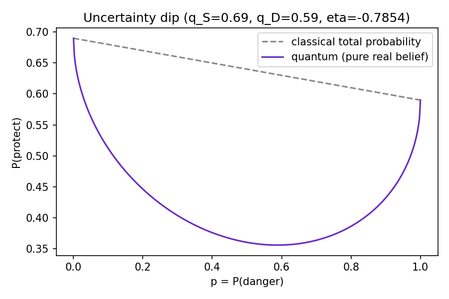
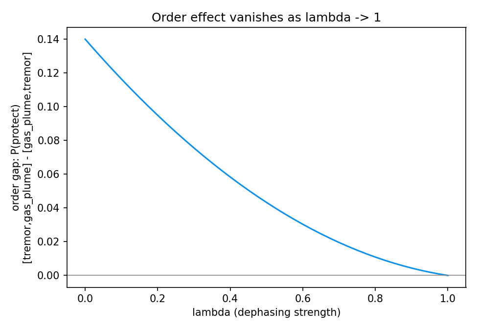
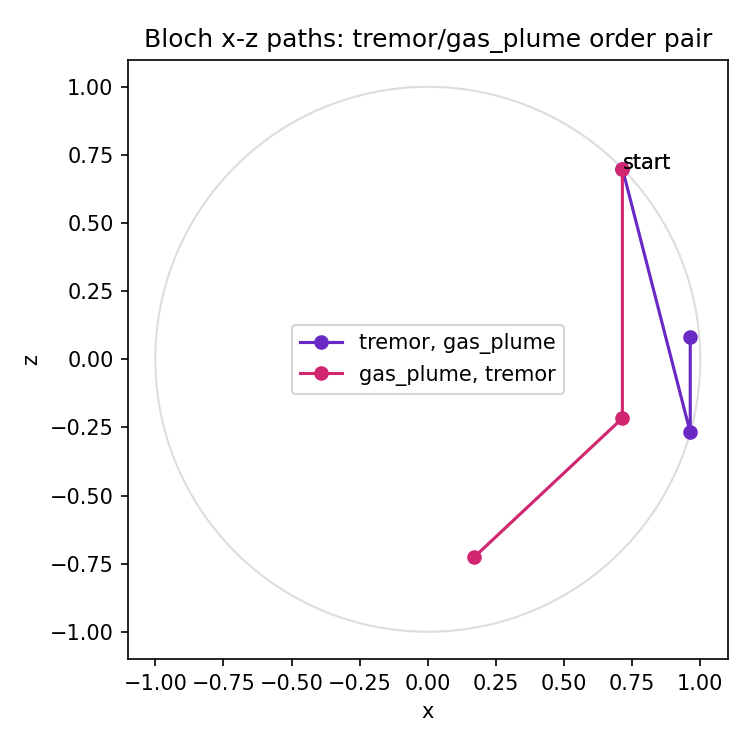
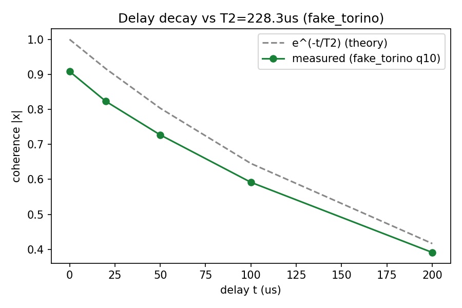

# Validation report

_Generated by `mind/experiments/validate.py` on 2026-11-04T20:01:20.157466+00:00._

## 1. Stage 1-8 tests

### Stage 1 - deliberation unitary
`$ C:\Users\lenovo\AppData\Local\Microsoft\WindowsApps\PythonSoftwareFoundation.Python.3.13_qbz5n2kfra8p0\python.exe -m pytest -v mind/tests/test_model.py`
```
============================== 6 passed in 0.81s ==============================
```

### Stage 2 - belief, events, collapse
`$ C:\Users\lenovo\AppData\Local\Microsoft\WindowsApps\PythonSoftwareFoundation.Python.3.13_qbz5n2kfra8p0\python.exe -m pytest -v mind/tests/test_belief.py`
```
============================== 6 passed in 0.36s ==============================
```

### Stage 3 - stress as decoherence
`$ C:\Users\lenovo\AppData\Local\Microsoft\WindowsApps\PythonSoftwareFoundation.Python.3.13_qbz5n2kfra8p0\python.exe -m pytest -v mind/tests/test_decoherence.py`
```
============================== 4 passed in 0.77s ==============================
```

### Stage 4 - decision function
`$ C:\Users\lenovo\AppData\Local\Microsoft\WindowsApps\PythonSoftwareFoundation.Python.3.13_qbz5n2kfra8p0\python.exe -m pytest -v mind/tests/test_quantum_mind.py`
```
============================= 15 passed in 0.85s ==============================
```

### Stage 6 - circuits and hardware
`$ C:\Users\lenovo\AppData\Local\Microsoft\WindowsApps\PythonSoftwareFoundation.Python.3.13_qbz5n2kfra8p0\python.exe -m pytest -v mind/tests/test_circuits.py`
```
======================== 2 passed, 3 skipped in 0.69s =========================
```

### Stage 8 - paper-backed cognition models
`$ C:\Users\lenovo\AppData\Local\Microsoft\WindowsApps\PythonSoftwareFoundation.Python.3.13_qbz5n2kfra8p0\python.exe -m pytest -v mind/tests/test_cognition_models.py`
```
============================= 12 passed in 0.72s ==============================
```

### Full repo suite (Tech C + all Tech A tests)
`$ SDL_VIDEODRIVER=dummy C:\Users\lenovo\AppData\Local\Microsoft\WindowsApps\PythonSoftwareFoundation.Python.3.13_qbz5n2kfra8p0\python.exe -m pytest -q test_contracts_and_engine.py mind/tests`
```
112 passed, 3 skipped, 1 warning in 6.35s
```

## 2. Batch statistics (volcano, seeds 0-199)

`$ python -m mind.experiments.validate` (this report), 200 seeds, minds: quantum, classical_mixture (control), classical (argmax stub, reference)

| Mind | Survival rate |
| --- | --- |
| quantum | 99.5% |
| classical_mixture | 99.5% |
| classical | 100.0% |

**Paired evacuation delay, quantum minus classical_mixture** (steps from first volcanic sign to first `hide`; seeds where both minds evacuated):

- n = 135 paired seeds
- mean = -0.919 steps, SE = 0.115
- quantum later: 0, earlier: 57, same: 78
- two-sided sign test p = 0.0000

**Survival, McNemar's exact test (quantum vs classical_mixture, discordant seeds only):**

- quantum survived & mixture died: 1; quantum died & mixture survived: 1
- p = 1.0000

**Action divergence (quantum vs classical_mixture), reflex-overridden steps excluded:**

- 2436 / 6954 compared steps differ (35.0%)
- 232 steps excluded (reflex fired for either mind)

## 3. Prototype preview comparison (40 seeds, stub prior)

Compared against, not copied from, `TECH_A_BUILD_PLAN.md` Section 7's prototype preview (40 seeds): quantum hid 1.84 steps later than mixture (SE 0.6, 19 later/4 earlier/14 same, sign test p~0.003); survival 45% vs 42%; actions differed on 17% of 1303 steps.

| | This run (first 40 of the seeds above) | Plan's prototype preview |
| --- | --- | --- |
| quantum survival | 100.0% | 45% |
| mixture survival | 100.0% | 42% |
| evac delay (quantum-mixture) | -0.857 steps, SE 0.223, sign p=0.0005 (0 later/12 earlier/16 same) | +1.84 steps, SE 0.6, p~0.003 (19/4/14) |
| action divergence | 34.5% of 1395 steps | 17% of 1303 steps |

## 4. Library & Published Quantum Cognition Cross-Checks (D8)

- `qcog`: not available (ModuleNotFoundError); verified via built-in mind.cognition_models
- `quantum_mind`: not available (ModuleNotFoundError); verified via built-in mind.cognition_models
- `Wang-Busemeyer QQ Equality (WileQ/QCog)`: PASS (qq_gap=1.11e-16, order_effect=+0.0744)
- `2D Luders Representability (ProfessorBrunner)`: PASS (realizable=True)
- `Huang QLBN Belief Entropy (Insight137/insight137-eap)`: PASS (D_b=-0.4855 vs published -0.9420)
- `Busemeyer 2-Qubit Hamiltonian (jbusemey/ChoiceModeling)`: PASS (max|U^dagger U - I|=4.44e-16)

## Figures









